# Sources CFC pour le guichet commercial et l’octroi de crédit

**Recherche effectuée le :** 19 novembre 2026  
**Périmètre :** parcours client, produits, épargne, demandes de crédit, BET/notaires, pouvoirs de décision, mise en place, décaissements et remboursement.  
**Méthode :** sources publiques détenues par le CFC et lecture en consultation seule des migrations et seeds du dépôt. Les constats ci-dessous ne constituent pas une délégation de pouvoir, un avis juridique ou une validation de politique métier.

## Résumé exécutif

Les sources publiques du CFC confirment une partie importante du parcours décrit dans le compte rendu : prise de contact à distance ou en agence, examen de recevabilité lors du dépôt en agence, analyse de solvabilité et de faisabilité, décision motivée, constitution des garanties, puis versements par tranches constatées en fonction de l’avancement du projet. Le site décrit aussi séparément le compte d’épargne libre et le plan d’épargne logement destiné à constituer l’apport d’un prêt.

Les sources disponibles ne suffisent pas à transformer en règles système les seuils d’autorité, la possibilité de plusieurs prêts en cours, la multiplicité des comptes d’épargne, ni les exceptions de choix d’un notaire externe. Les pages de pouvoirs et le guide classique sont incompatibles entre eux, et certains documents publics sont anciens. **Aucun seuil ni taux du seed ne doit donc servir de politique d’approbation ou de catalogue officiel sans validation par les documents CFC en vigueur.**

Le recueil de besoins fourni en réunion reste la source métier la plus précise pour les conditions de présence physique, les propositions de BET/notaire et la séparation entre plusieurs demandes et un crédit actif. La décision produit donnée dans cette conversation autorise plusieurs demandes encore en instruction, avec au plus un crédit actif par client. Les sources publiques consultées ne valident ni n’infirment cette décision.

## Parcours du client et étapes en agence

La page CFC [Pratiques](https://creditfoncier.cm/fr/qui-sommes-nous/gouvernance/pratiques.html) décrit neuf étapes. Elle cite plusieurs canaux d’entrée en relation, y compris le téléphone, WhatsApp, le site web et les commerciaux des agences régionales. Elle indique qu’un entretien exploratoire sert à comprendre le besoin, présenter les produits possibles, simuler le prêt, élaborer un plan de financement et expliquer les pièces attendues. La maturation du projet peut inclure l’accompagnement commercial et l’expertise BET/architecte.

La même page place l’analyse sommaire de recevabilité **lorsque le prospect s’est rendu en agence pour déposer son dossier**, où le commercial vérifie exhaustivité et conformité. Elle décrit ensuite la vérification approfondie de la solvabilité, de la faisabilité technique et de l’équilibre du financement, avec une visite du terrain. Cela corrobore un guichet physique au moins pour le dépôt et le contrôle de recevabilité. Le site ne décrit pas un parcours complet de vérification d’identité à distance.

Le compte rendu métier §§ 4.1–4.3 précise que le client doit actuellement se présenter à l’agence pour son entretien avec son chargé de clientèle et que la vérification d’identité est présentielle ; aucune vérification complète à distance n’a été confirmée. Cette exigence est une information issue de la réunion, et non une règle que la page publique détaille. L’application peut préparer à distance les données, pièces et rendez-vous, mais le statut « identité vérifiée » doit attendre la preuve prévue par le CFC et la confirmation du personnel autorisé.

La [page de présentation du réseau commercial](https://creditfoncier.cm/fr/qui-sommes-nous/le-cfc/au-plan-organisationnel.html) donne les agences par région. Elle ne fournit pas une règle d’affectation automatique des demandes, une liste nominative du personnel habilité ou une procédure de suppléance. Ces règles doivent venir du référentiel RH/agences et d’une validation interne.

## Catalogue de produits, taux et pièces

Le CFC publie une [offre de prêts](https://www.creditfoncier.cm/fr/produits-prets/pret-foncier-classique.html) qui distingue notamment les prêts classique, locatif, promoteur et aux collectivités, ainsi que des variantes classiques (jeune, social, acquéreur, ordinaire). Les pages de produits exposent des documents utiles qui varient selon le produit et le profil du client. Le [prêt classique ordinaire](https://www.creditfoncier.cm/fr/produits-prets/pret-foncier-classique/pret-foncier-classique-ordinaire.html) indique publiquement un plafond de 150 millions FCFA, une durée jusqu’à 25 ans, un taux TTC de 6 %, un différé total de 1 à 12 mois et un apport minimal de 20 % sous réserves de capacité d’endettement et de couverture du risque. Le [prêt classique acquéreur](https://www.creditfoncier.cm/fr/produits-prets/pret-foncier-classique/pret-foncier-classique-acquereur.html) indique également un plafond de 150 millions, une durée jusqu’à 25 ans et un taux de 6 %, mais un apport minimal de 10 % ; il est réservé aux programmes ayant une convention ou un partenariat avec le CFC et indique que le titre foncier et le dossier technique ne sont pas exigés au dépôt de cette demande.

Ces deux pages montrent pourquoi une seule règle de taux, d’apport, de durée ou de documents ne peut pas être appliquée à tout le catalogue. Le compte rendu métier § 4.2 demande précisément le catalogue actualisé, les formulaires et les modèles actuellement employés. Les sources publiques consultées ne permettent pas d’établir que tous ces documents sont à jour ni de reconstruire toutes les règles produit. Il faut obtenir les fiches tarifaires, formulaires, pièces par profil/projet, conditions d’éligibilité et dates d’effet validées par le CFC.

Le seed courant propose des produits et paramètres qui divergent des pages officielles consultées : par exemple, [le seed `PFC_ORD_15`](../../supabase/seed.sql#L338) porte un plafond de 35 millions, 15 ans et un taux standard de 5,75 %, tandis que la page publique du produit ordinaire indique 150 millions, 25 ans et 6 %. Le seed contient aussi des produits intitulés « lotissement » ou « crédit solidaire » dont les valeurs ne sont pas justifiées par les pages consultées. Ces entrées peuvent être des fixtures de développement ; elles ne sont pas une preuve de politique CFC et ne doivent pas alimenter une offre affichée comme réelle sans catalogue approuvé.

## Épargne, pluralité de comptes et compte d’opérations

La page CFC [Compte d’Épargne](https://www.creditfoncier.cm/fr/produits-epargne-logement/compte-d-epargne.html) différencie le compte d’épargne libre du plan d’épargne logement : le premier a pour objet l’épargne et sa rémunération et peut être ouvert par une personne physique ou morale ; le second sert à constituer l’apport en vue d’obtenir un prêt immobilier. Cette source soutient l’indépendance d’un compte d’épargne libre par rapport à la demande d’un prêt. Elle ne dit pas combien de comptes une personne peut ouvrir. La pluralité de comptes est rapportée par le compte rendu § 4.2 ; elle n’est pas corroborée par une règle publique trouvée.

Dans le schéma présent, `public.savings_accounts` identifie séparément un compte par `account_number`, avec des liens facultatifs vers un dossier et un client ; l’index unique porte uniquement sur le numéro de compte. Le schéma permet donc plusieurs lignes pour un même client, mais cette permissivité technique ne constitue pas une politique métier. Voir [migration épargne](../../supabase/migrations/20260101000008_savings.sql#L3).

Le compte rendu précise que le compte d’opérations utilisé pour les transactions du CFC est distinct de l’épargne du client. Les migrations consultées ne définissent pas d’entité `operations_account` dédiée ; la table [dossiers](../../supabase/migrations/20260101000006_dossier_core.sql#L12) contient toutefois un champ `account_number`, en plus de `public.savings_accounts`. Il existe donc un risque de présenter ou de réutiliser le numéro d’un dossier comme compte d’épargne ou compte d’opérations. Il faut faire confirmer le propriétaire, le cycle de vie et les relations de chacun de ces comptes avant de les connecter aux écritures ou aux échéances.

## Demandes de crédit, crédit actif et concurrence

Le compte rendu de réunion décrit comme non admise ou non confirmée la souscription simultanée de plusieurs crédits. La clarification produit ultérieure donnée dans la conversation fixe la règle à concevoir ainsi : **plusieurs demandes de crédit peuvent être ouvertes/en instruction ; un seul crédit peut être actif**. Une FAQ/fiche produit CFC explique que l’évaluation de capacité tient compte de la quotité restante lorsqu’un client a déjà un crédit en cours d’amortissement, et évoque le remboursement d’un premier prêt par un nouveau prêt CFC plus important. Ces éléments montrent que des engagements existants et des opérations de remplacement sont pris en compte, mais ils ne constituent pas une autorisation explicite de cumuler deux crédits CFC actifs. Il faut distinguer la demande, l’offre, l’acceptation de l’offre et le contrat de crédit en cours ; les sources publiques consultées ne définissent pas la règle de concurrence retenue dans cette conversation.

Le modèle courant a une racine `public.dossiers` pour les demandes, puis des `public.loan_offers` reliées chacune à un dossier, avec les états `draft`, `issued`, `accepted`, `refused` et `expired` ([migration crédit](../../supabase/migrations/20260101000009_credit.sql#L43)). La recherche dans les migrations courantes a trouvé des tables de demandes/offres et de décaissement, mais pas de registre distinct de contrats de crédit actifs ou de calendrier de remboursement. En conséquence, `loan_offers.status = 'accepted'` ne suffit pas à établir qu’un crédit est actif ou clôturé. La règle « un crédit actif » devra être attachée à un événement/registre contractuel faisant autorité, après validation des états de début et de fin d’activité.

## BET et notaires

Le CFC indique sur sa page [Suivi de la réalisation des projets financés](https://www.creditfoncier.cm/fr/suivi-de-la-r%C3%A9alisation-des-projets-financ%C3%A9s.html) qu’il met une liste de professionnels agréés à disposition, que le choix du professionnel revient au client, et que le suivi/contrôle du projet financé doit être confié à un professionnel agréé. La page autorise des professionnels non agréés pour la conception, les études de marché et de rentabilité. Elle prévoit une exception pour un BET ou cabinet d’architecture inscrit à son ordre professionnel, sous contrat de maîtrise d’œuvre, qui adhère à une charte CFC. L’annexe publiée est nommée « Liste des BET agréés 2023–2024 » ; sa date rend nécessaire une vérification auprès du CFC avant de s’en servir comme répertoire actif.

La formulation métier de la réunion (§ 4.4) permet au client de constituer son dossier technique avec son propre professionnel ; le CFC analyse les documents et peut demander des corrections. Elle est cohérente avec le choix client décrit sur le site, mais elle ne remplace pas les conditions spécifiques au contrôle de chantier. L’application doit distinguer le rôle de conception, l’expertise de dossier, la supervision et le contrôle du chantier, et demander le statut d’agrément/ordre/charte applicable à chaque rôle.

Pour les notaires, le guide classique public indique la domiciliation des procédures foncières chez un notaire agréé par le CFC. Le compte rendu de réunion mentionne un réseau de notaires conventionnés, la possibilité pour le client d’en proposer un autre sous réserve de conditions et le risque de délais supplémentaires. Les sources publiques consultées n’ont pas confirmé l’exception de choix d’un notaire externe ni ses critères. Cette exception reste à documenter auprès du service juridique/notarial ; ne pas afficher un choix libre ou imposer le réseau sans la règle en vigueur.

## Délégations de décision et seuils

Les seuils du compte rendu §§ 5.3 contiennent plusieurs niveaux (agences de catégories I/II, seuils 8/15 millions, direction générale sous 100 millions, comité de crédit à 100–300 millions, conseil d’administration au-delà de 300 millions), et le compte rendu signale lui-même l’ambiguïté ainsi que l’absence du document de délégation. Les formulations ne suffisent pas à dériver des intervalles disjoints ni à savoir si chaque étape donne un avis ou une décision finale.

La page officielle [Pratiques](https://creditfoncier.cm/fr/qui-sommes-nous/gouvernance/pratiques.html) publie un autre découpage : CIEPA pour les demandes inférieures à 8 millions, CRC de 8 à 100 millions, CGR de 100 à 300 millions, Conseil d’administration de 300 à 500 millions, avec des délais indicatifs de 7, 26, 45 et 60 jours. Elle distingue les issues accord, ajournement pour complément ou refus, et précise que l’accord transmet les conditions de mise en place au client. Cependant, les intervalles tels que publiés ont des frontières qui se chevauchent à 8, 100 et 300 millions ; la page n’indique pas de date d’effet ni les délégations/signatures applicables aux agents.

La page de gouvernance [Comités spécialisés](https://creditfoncier.cm/fr/qui-sommes-nous/gouvernance/comites-specialises.html) dit que le Comité de Crédit examine les demandes d’au moins 100 millions et autorise des prêts jusqu’à 300 millions. Elle n’établit pas à elle seule les bandes d’intervention des autres comités ni les délégations d’agence. Le guide classique, plus ancien, attribue au directeur d’agence la décision pour un prêt inférieur ou égal à 8 millions et un avis à partir de 8 millions, ce qui chevauche exactement au seuil de 8 millions et diffère de la page Pratiques.

Le conflit existe également dans le seed : [les lignes `CGR_DELEGATION`, `CRC_ARBITRAGE`, `PCA_INSTITUTIONNEL`](../../supabase/seed.sql#L471) codent respectivement 0–10 millions, 10–25 millions et plus de 25 millions avec des codes d’instance qui ne correspondent pas au découpage public de la page Pratiques. Ce sont des valeurs hardcodées sans justificatif identifié dans le dépôt. **Décision recommandée pour la mise en œuvre : aucun de ces seuils ne doit déclencher une décision ou une affectation réelle tant que le CFC n’a pas fourni la délégation en vigueur, incluant seuils inclusifs/exclusifs, dénomination de chaque instance, nature avis/décision, quorum/signatures, délégations d’agence, date d’effet et règles de remplacement.**

## Mise en place, décaissements et remboursement

La page [Pratiques](https://creditfoncier.cm/fr/qui-sommes-nous/gouvernance/pratiques.html) distingue la prise des garanties (signature de la convention, modalités de remboursement, hypothèque) et la mise en gestion. Elle indique que le prêt n’est pas remis en totalité au client : notaire et assureur reçoivent leurs parts, et la part travaux est versée au client en deux, trois ou quatre tranches selon la taille et l’avancement du projet. Le guide classique public confirme des acomptes successifs constatés par les services techniques du CFC. Cela correspond aux étapes de déblocage progressif du compte rendu § 5.5, qui ajoute les visites, photos, rapports et validations internes.

La page produit de prêt classique ordinaire indique un différé total de 1 à 12 mois, tandis que le guide classique ancien évoque 1 à 24 mois puis des échéances mensuelles débitées du compte d’opérations. Ces nombres ne doivent pas être généralisés entre produits ni traités comme actuels en l’absence d’un échéancier et d’une offre de produit validés. Le guide pratique du prêt locatif couvre en outre le suivi, le remboursement et la fin du prêt, mais son ancienneté publique (plus de 11 ans dans l’index consulté) limite sa valeur comme politique courante.

Le schéma local contient `public.disbursements` et `public.disbursement_schedules` ([migration décaissement](../../supabase/migrations/20260101000011_disbursement.sql#L3)), et le catalogue de phases a six phases allant de l’instruction à la mainlevée ([catalogue de phases](../../supabase/migrations/20261118170000_process_phase_catalogue.sql#L15)). Ces structures offrent des points d’ancrage pour le flux, sans démontrer que les contrôles réels d’inspection, les pièces exigées, les montants par tranche ou les écritures comptables sont complets. Le compte rendu signale que le remboursement, la clôture et le recouvrement n’ont pas été assez détaillés.

## Diagramme de flux à valider

Le diagramme combine les étapes publiées par le CFC et les précisions du compte rendu ; il représente un **parcours de travail à confirmer**, pas une règle de décision ou d’éligibilité codable en l’état.

```mermaid
flowchart LR
  A[Contact à distance ou agence] --> B[Entretien exploratoire et simulation]
  B --> C[Maturation du projet et pièces]
  C --> D[Présence en agence et contrôle de recevabilité]
  D --> E[Instruction: solvabilité, technique, financement]
  E --> F[Visite du site si applicable]
  F --> G[Avis et contrôles intermédiaires]
  G --> H{Autorité disposant de la délégation en vigueur}
  H -->|Accord final| I[Offre notifiée et acceptée]
  H -->|Ajournement| C
  H -->|Refus| J[Demande clôturée]
  I --> K[Garanties, assurance, notaire et convention]
  K --> L[Décaissements par tranches après conditions et constats]
  L --> M[Remboursement, clôture et mainlevée]
  M -. détails à confirmer avec les métiers .-> N[Échéancier, recouvrement, dénouement]
```

## Conflits et questions à fermer avant d’en faire des règles système

| Sujet | Ce qui est établi | Ce qui reste non résolu | Source métier à obtenir |
|---|---|---|---|
| Présence et identité | Le compte rendu dit entretien et contrôle d’identité en présentiel ; le site confirme au moins le dépôt de dossier en agence. | Étapes exactes qui nécessitent une présence, preuve de contrôle, mandat, exceptions diaspora et critères de vérification à distance. | Procédure KYC et procédure de guichet approuvées. |
| Catalogue | Le site montre des produits distincts, exigences et paramètres différents. | Catalogue complet/actualisé, dates d’effet, documents par produit/profil/projet, conditions qui lient un crédit à l’épargne. | Catalogue tarifaire et formulaires maîtres par produit. |
| Épargne | Compte libre et plan d’épargne logement sont deux produits distincts ; le schéma permet plusieurs lignes par client. | Nombre de comptes permis, règles d’ouverture/clôture et lien obligatoire éventuel d’un produit de crédit. | Règlement d’épargne et procédure de gestion des comptes. |
| Concours de crédit | La décision produit de la conversation autorise plusieurs demandes et un crédit actif. Le CFC tient compte des crédits déjà amortis dans la capacité et décrit une opération de rachat/remplacement. | Cela n’établit pas si un deuxième crédit CFC peut coexister avec un premier crédit CFC. Définition d’« actif » (décision, offre acceptée, contrat signé, premier décaissement, solde non nul) et règle de refinancement/remplacement. | Politique d’octroi et gestion de portefeuille validée. |
| BET | Choix client dans certaines limites ; l’agrément et la charte varient selon le rôle du professionnel. | Conditions de correction/acceptation d’un dossier réalisé par un BET externe, liste agréée à jour. | Procédure BET et liste active des agréés. |
| Notaire | Le vieux guide classique parle d’un notaire agréé CFC. | Choix externe, validation, pièces, frais et délais applicables aujourd’hui. | Convention/référentiel notarial actuel. |
| Délégation | Pages publiques divergentes et seed en contradiction avec elles et le compte rendu. | Seuils disjoints, autorité par catégorie d’agence, avis vs décision, signatures et entrée en vigueur. | Document signé de délégation de pouvoirs et procédure de comité. |
| Décaissement et remboursements | Les travaux sont payés en tranches avec inspection ; les parts de frais peuvent aller directement au notaire/assureur. | Liste des conditions de libération, grille de tranches, pièces/avis, remboursement exact, pénalités, recouvrement et mainlevée. | Procédure comptable et opérationnelle de mise en gestion, recouvrement et clôture. |

## Sources publiques et limites d’autorité

Les liens ci-dessous sont des sources de première partie (site CFC). La date d’accès est le 19 novembre 2026. Les pages HTML ne montrent pas toujours leur date de publication ou d’effet ; le copyright de pied de page est 2021 et les dates de crawl des moteurs ne prouvent pas qu’une procédure a été révisée. Les guides classiques/locatifs proviennent d’anciens fichiers PDF (environ 11 ans dans l’index consulté). La liste BET visible concerne 2023–2024. Il faut demander confirmation d’actualité au CFC pour tout chiffre ou règle opérationnelle.

| Source | Autorité/actualité observée | Utilisation dans cette note |
|---|---|---|
| [Pratiques](https://creditfoncier.cm/fr/qui-sommes-nous/gouvernance/pratiques.html) | Publication CFC en ligne ; date d’effet non affichée. Source descriptive la plus détaillée du parcours public. | Étapes, contrôle en agence, instruction, comités publiés, offre, garanties et tranches. |
| [Comités spécialisés](https://creditfoncier.cm/fr/qui-sommes-nous/gouvernance/comites-specialises.html) | Publication CFC de gouvernance ; date d’effet non affichée. | Mandat public du Comité de Crédit, limité à son champ annoncé. |
| [Suivi des projets financés](https://www.creditfoncier.cm/fr/suivi-de-la-r%C3%A9alisation-des-projets-financ%C3%A9s.html) | Publication CFC ; annexe BET expressément nommée 2023–2024. | Rôle et choix BET, exigence d’agrément pour suivi/contrôle et exception de charte. |
| [Prêt classique ordinaire](https://www.creditfoncier.cm/fr/produits-prets/pret-foncier-classique/pret-foncier-classique-ordinaire.html) et [prêt acquéreur](https://www.creditfoncier.cm/fr/produits-prets/pret-foncier-classique/pret-foncier-classique-acquereur.html) | Pages produits CFC ; les paramètres peuvent évoluer, dates d’effet non affichées. | Exemples montrant les différences de paramètres, d’éligibilité et de pièces. |
| [Compte d’Épargne](https://www.creditfoncier.cm/fr/produits-epargne-logement/compte-d-epargne.html) | Page CFC ; date d’effet des taux affichés non déterminée ici. | Séparation entre épargne libre et plan d’épargne logement ; n’atteste pas la pluralité. |
| [FAQ CFC](https://www.creditfoncier.cm/fr/questions-r%C3%A9currentes.html) et [fiche prêt classique](https://www.creditfoncier.cm/fr/88-nos-produits/index.php?Itemid=243&id=1&lang=fr&option=com_djcatalog2&view=item) | Pages officielles ; entrées publiées/crawlées il y a plusieurs années selon l’index. Elles ne sont pas une délégation actuelle. | Capacité calculée en tenant compte des crédits en cours et possibilité de rachat/remplacement ; ne confirme pas le cumul de crédits CFC. |
| [Guide pratique du prêt classique](https://www.creditfoncier.cm/fr/component/phocadownload/category/5-le-guide-de-l-emprunteur.html?download=3%3Aguide-pret-foncier-classique) | PDF CFC identifié comme ancien (environ 11,4 ans dans l’index consulté). Moins autoritaire pour les seuils courants. | Démarches, BET, notaire, compte d’opérations, garanties, décaissements, remboursements ; source historique contradictoire. |
| [Guide pratique du prêt locatif](https://creditfoncier.cm/fr/component/phocadownload/category/5-le-guide-de-l-emprunteur.html?download=4%3Aguide-pratique-pret-foncier-locatif) | PDF CFC ancien (environ 11,5 ans dans l’index consulté). | Repérage du cycle d’instruction, de déblocage et de fin de prêt ; ne valide pas une politique actuelle. |

