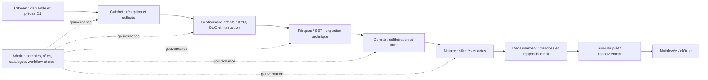
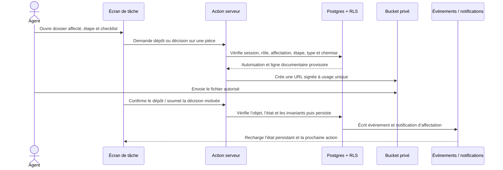

# Audit des écarts de parcours par rôle — portail CFC

**Date :** 19 novembre 2026  
**Branche comparée :** `develop` (`fbc70cb`, avec les changements de travail visibles dans le checkout au moment de l’audit)  
**Références upstream :** `main` et branches UI citées dans [`upstream-ui-reference-audit.md`](./upstream-ui-reference-audit.md).  
**Périmètre :** menus et routes, données persistées, affordances d’upload/validation, couverture des scénarios locaux/staging. Audit en lecture seule : aucune app, migration ou seed n’a été modifié.

## Synthèse

Le checkout courant est déjà plus robuste que les branches UI historiques sur la séparation entre présentation et vérité métier : les listes opérationnelles lisent Supabase sous RLS; l’upload DUC suit un flux Storage privé; le rôle, la chemise et le dossier sont revérifiés côté serveur; et plusieurs pages signalent explicitement l’absence de registre au lieu de fabriquer des dossiers ou opérations. Les vues cartes/tableau et grille/liste visibles dans le checkout courant partagent leurs résultats au lieu d’ajouter une seconde source de données.

L’écart principal est maintenant **l’action métier par rôle**. Plusieurs rôles disposent de capacités serveur de dépôt, validation ou décision, mais leurs pages n’affichent qu’une file descriptive ou un registre en lecture. À l’inverse, le DUC gestionnaire/client porte le flux générique de document. Il faut relier chaque action documentaire à une étape et une pièce attendue, puis à l’affectation du dossier et au rôle destinataire; l’action serveur et RLS doivent appliquer le même contrat.

Les registres `notary_instruments`, `land_titles`, `oppositions`, `insurances`, `committee_deliberations`, `loan_offers`, `disbursements` et `reconciliation_runs` existent. Cela ne prouve pas qu’une page sache les créer ou faire progresser leurs états : `OperationalRegisterPage` ne fait qu’interroger et présenter les lignes. Les répertoires BET, notaires, promoteurs, recouvrement et subventions affichent au contraire une notice disant qu’il manque un registre métier; ils ne doivent pas recevoir des données inventées pour remplir les tableaux.

Le seed de comptes crée sept rôles staff et trois clients, et ouvre un compte d’épargne pour les dossiers de démonstration avec un solde positif. Il ne fournit pas encore de scénario relié aux décisions de comité, offres, actes notariés, décaissements, réconciliation, recouvrement ou mainlevée. Le seed doit étendre les étapes qui ont une écriture métier existante; les modules sans schéma doivent rester en état vide explicatif jusqu’à la livraison de leur contrat de données.

## Parcours et points de contrôle

Le diagramme représente les responsabilités attendues, pas une machine d’état entièrement implémentée. Les routes des pôles et les files constituent aujourd’hui le point d’entrée UI; la plupart des transitions propres à BET, comité, notariat et décaissement restent à construire.

## Matrice des rôles

| Rôle | Routes / données dans `develop` | Upload et décisions : affordance actuellement prouvée | Écart concret et scénario à couvrir |
|---|---|---|---|
| **CITIZEN** | `/portail-client`, onboarding et `/portail-client/demandes`; ses dossiers, demandes, profil KYC et pièces sont filtrés par propriété. Le seed crée `emprunteur@cfc.cm`, `emprunteur.diaspora@cfc.cm` et `emprunteur.pieces@cfc.cm`. | Le client peut renseigner son dossier et transmettre les pièces KYC/DUC prévues par le parcours. Le stockage privé s’appuie sur le propriétaire du dossier et la chemise client; le client ne décide jamais du KYC d’un autre acteur. | Ajouter des exemples d’états distincts par demande : brouillon, pièce attendue, KYC soumis/à corriger, et progression ultérieure si le modèle persistant la couvre. Garder la règle produit validée : plusieurs demandes peuvent coexister; un seul crédit peut être actif. Ne pas confondre plusieurs demandes avec plusieurs prêts actifs. |
| **GUICHET** | `/actors/agency`, `/mobile-money`, `/simulator`, `/dossiers`, `/clients`. Files de dossiers et opérations MoMo lisent les tables réelles. | Capacités `document:upload/request/validate/reject`, `savings:credit/validate`; dépôt limité par `canWriteChemise()` et l’autorisation dossier de `src/server/storage/upload.ts`. Le rôle ne possède pas `kyc:read`, `kyc:verify` ni `kyc:decide` dans la matrice TS. | Les menus présentent l’enrôlement, la collecte et les pièces DUC, mais il manque une action contextualisée par tâche/chemise pour réceptionner ou demander une correction. Les fixtures devraient couvrir une pièce attendue, téléversée puis rejetée/validée, et un versement en attente puis validé — les écritures doivent être faites par le seed à travers des règles cohérentes. |
| **GESTIONNAIRE** | `/dossiers`, `/clients` avec détail DUC, KYC et épargne, Kanban de suivi; `getStaffDossiers` lit dossiers, documents, événements, comptes et transactions sous RLS. | Capacités `kyc:read/verify/decide`, `document:upload/request/validate/reject`, décisions dossier et épargne. La file `KycValidationQueue` affiche les états suivants autorisés et envoie la décision à `advanceKycAction`; les détails KYC sont la voie à utiliser pour les gestionnaires affectés. | Vérifier que toute lecture et décision KYC est bornée au gestionnaire affecté au dossier et aux étapes permises, et afficher cette affectation dans la file. Ajouter des cas dédiés KYC à corriger, contrôle renforcé et changement de gestionnaire; aucun compte inactif ne doit apparaître comme responsable disponible. |
| **RISQUES_BET** | `/actors/risk-engineering`, `/site-reports`, `/solvency`, `/geotech-urban`; files basées sur la projection sûre de dossiers (code DUC, région, agence, phase, état), avec lien vers l’état opérationnel. `/directory` est une `PersistenceNotice`. | La matrice accorde `document:upload`, `document:validate`, `dossier:update`; les queues courantes sont essentiellement recherche, grille/liste et lien d’état. Aucun formulaire d’expertise ou de dépôt BET propre à la phase n’est rendu dans ces routes. | Construire l’action rapport/devis/scoring sur le bon registre et la pièce de l’étape, avec un dossier réellement orienté à G3. Le répertoire BET attend un schéma partenaire avant CRUD ou fixtures. |
| **NOTAIRE** | `/actors/notary-cadastre`, `/cadastre-docs`, `/insurances`, `/oppositions`; les registres lisent `notary_instruments`, `land_titles`, `oppositions`, `insurances`. `/directory` signale l’absence de répertoire persistant. | Capacités `document:upload/validate/reject` et `notary:draft/record/release`; les routes actuelles appellent le registre générique en lecture seule. Le schéma possède des instruments et titres fonciers, mais aucune preuve de formulaire de rédaction/enregistrement dans ces pages. | Mettre en place un cas assigné au notaire, dépôt d’acte/pièce C3, validation et état de sûreté dans l’instrument. Le répertoire conventionné demande son modèle à part. Ne pas créer de pseudo-notaire en dur dans l’UI. |
| **COMITE** | `/actors/credit-committees`, `/cgr`, `/crc`, `/board-institutional`, `/loan-offers`; `committee_deliberations`, `deliberation_lines` et `loan_offers` sont les sources actuelles des registres. | Capacités `committee:deliberate/sign`, `loan_offer:create/issue`, `disbursement:release`, `recovery:manage`; les pages de registre consultent uniquement les données persistées et ne proposent pas de formulaire de délibération ou d’émission d’offre. Aucune capacité d’upload documentaire n’est incluse dans `permissions.ts`. | Relier une expertise achevée à une séance, quorum, avis et décision; émettre une offre persistée puis exposer son état au client. Ajouter des fixtures réelles de comité et offre, avec lignes de délibération et liens DUC; ne pas inventer une décision seulement dans la carte UI. |
| **ADMIN** | `/analytics`, supervision des registres, `/settings/catalogue`, `/settings/email` et journal des envois. Le menu de paramétrage expose le catalogue documentaire et l’email. | Matrice étendue sauf `kyc:read/verify/decide`; capacités `admin:users/roles/audit` existent dans le modèle. La navigation courante n’expose pas de gestion complète utilisateurs, groupes, workflow, rôles/permissions, ni SMTP opérationnel. | Ajouter un centre de gouvernance avec comptes, groupes/affectations, workflow, rôles/capacités effectifs, paramètres SMTP/secrets, audit et récupération/réinitialisation par Auth. Toute donnée de seed reste locale/staging; aucune UI ne doit révéler un secret SMTP. |
| **DIASPORA** | `/actors/agency/diaspora`, `/dossiers`, `/clients`; le seed a un dossier diaspora au stade `risk_bet`. Les rôles reçoivent une navigation distincte mais partagent le DUC. | Capacités `document:upload/request/validate/reject`, collecte d’épargne, lecture/création/mise à jour dossier; KYC complet réservé au gestionnaire. | Compléter les scénarios mandat/procuration, non-résident et pièces manquantes dans les dossiers reliés aux vraies chemises et services. Les actions de contrôle KYC restent au gestionnaire habilité, pas au guichet diaspora. |

### Acteurs affichés dans le menu mais sans rôle d’authentification spécialisé

Le menu montre aussi des surfaces G7 (décaissements), G4 (mainlevée) et le pôle promoteurs. Les types `StaffRole` sont `GUICHET`, `GESTIONNAIRE`, `RISQUES_BET`, `NOTAIRE`, `COMITE`, `DIASPORA` et `ADMIN`; il n’existe pas de rôle staff G7/G4/partenaire dans cette taxonomie. Les routes correspondantes sont visibles dans la section admin, mais les rôles dédiés et l’attribution des permissions doivent être conçus avant d’ouvrir ces flux à des utilisateurs spécialistes.

## Pièces et transitions

| Étape / acteur | UI actuelle | Source et vérification | Travail prioritaire |
|---|---|---|---|
| Client → dossier | Dropzone/onboarding et gestionnaire DUC; chemises C1/C2/C3 et référentiel de type de document | `DocumentUploader`/`src/server/storage/upload.ts` crée d’abord une ligne `awaiting_upload`, vérifie rôle, chemise, dossier, empreinte, type MIME et taille, puis fournit une URL signée privée. Les policies Storage et `dossier_documents` relient l’objet au dossier; l’upload citoyen a sa règle propriétaire en migration `20260101000017_storage_documents.sql`. | Afficher, à chaque phase, la checklist issue du catalogue réellement applicable; rendre l’état `awaiting_upload/uploaded/under_review/validated/rejected` et le motif de correction visibles depuis le même dossier. |
| Gestionnaire → KYC | File interactive `KycValidationQueue`; actions d’avancement KYC tracées | `listKycQueueAction` / `advanceKycAction`, machine d’état KYC et journaux. La matrice de rôle retire la lecture/décision KYC à GUICHET/ADMIN; la portée d’affectation doit rester confirmée par les fonctions et RLS côté serveur. | Faire converger la fiche KYC, le DUC sélectionné, les pièces reçues et l’affectation active. Ajouter une fixture de contrôle renforcé et une de correction plutôt qu’un seul état “validé”. |
| BET / notaire / comité | Files et registres en lecture; upload générique possible dans le composant DUC selon capacité et chemise | Les composants experts ne relient pas actuellement une pièce à une tâche ou transition de leur pôle. Le rôle seul ne suffit pas pour permettre la lecture/décision d’un dossier, et une entrée de menu ne prouve pas une affectation. | Ajouter une matrice versionnée `phase × document_type × rôle × affectation × action`, validée par la même politique serveur/RLS; chaque décision crée un événement métier auditable et une notification au prochain responsable. |

## Registres, routes et persistance

| Surface actuelle | Route(s) et source | Ce qui persiste / limite constatée |
|---|---|---|
| Répertoire emprunteurs | `/clients`; `getStaffDossiers`, dossiers/DUC, compte d’épargne, transactions et événements | La vue grille/tableau courante réutilise les mêmes résultats. Le détail garde les filtres RLS; une projection n’accorde pas à un rôle les détails KYC. |
| Queue de pôle | `/actors/agency`, `/actors/risk-engineering/*`, `/actors/agency/diaspora` | `getOperationalDossiers` interroge les dossiers visibles sous RLS et n’en expose que les métadonnées allowlistées. `DossierQueueView` fournit recherche, bascule grille/liste et lien vers l’état opérationnel, sans action de workflow propre au pôle. |
| Registres financiers/juridiques | `OperationalRegisterPage` et `getOperationalRegister` | Lecture de tables persistées sous RLS; composant générique, pas d’actions d’écriture. Les migrations `20260101000009_credit.sql`, `...10_notary.sql`, `...11_disbursement.sql` établissent plusieurs schémas. |
| Répertoires absents | promoteurs, BET, études notariales, recouvrement, subventions | Pages avec `PersistenceNotice`; les tables métier dédiées ne sont pas présentes dans les migrations actives repérées. Ajouter d’abord modèle, permissions/RLS, actions et événements; seulement après les vues et jeux de données.
| Réglages admin | `/settings/catalogue`, `/settings/email`, `/settings/email/deliveries` | Le catalogue et les modèles/envois email ont des pages. Il n’y a pas de navigation `users`, `groups`, `workflow`, `roles`/permissions ou configuration SMTP complète dans la navigation active. |

## Couverture des données locale / staging

| Cas | Couverture observée dans `scripts/seed-dev-users.mjs` | Priorité de fixture |
|---|---|---|
| Roster staff par pôle et région | 11 comptes staff : GUICHET, plusieurs GESTIONNAIRE dans plusieurs agences/régions, un GESTIONNAIRE inactif, RISQUES_BET, NOTAIRE, COMITE, DIASPORA, ADMIN. Affectations et rattachements sont provisionnés par le script. | Garder actif/inactif et régions distincts; ajouter les profils/G7/G4 uniquement après définition des rôles. |
| Entrée / épargne / diaspora | 3 demandeurs : un dossier KYC/épargne avec 9 mois; un dossier diaspora `risk_bet` avec 48 mois et DUC actif; un dossier avec pièces et 14 mois. Plan de financement calculé par le domaine. Chaque dossier ayant un solde positif reçoit un compte et une ligne d’ouverture d’épargne idempotente. | Ajouter demandes multiples sur un même client conformément à la règle métier; cas de versement pending, rejected puis validated via valeurs reliées et règles métier. |
| KYC et documents | Timeline d’événements décrit soumission, demande de document, approbation ou dépôt selon chaque dossier; ce n’est pas une preuve de fichiers Storage pour chaque état. | Fournir de vrais petits fichiers non sensibles de fixture et des métadonnées de documents dans le bucket local; inclure manquant, en attente, rejeté avec motif et validé, sans données personnelles réelles. |
| Comité, offre, notaire, décaissement et cycle aval | Aucun cas explicite dans les tableaux `CITIZENS`/`STAFF` ni dans les écritures spécifiques consultées du seed utilisateur. Les tables existent pour comité, offre, notaire, titre, opposition, assurance, décaissement et rapprochement. | Ajouter un dossier cohérent à chaque état persisté déjà supporté, lié aux vrais DUC, actors, agency, délibération et événement. Garder les tables sans modèle métier (recouvrement, subvention, annuaire) vides avec notice. |

**Règle de seed :** les comptes et états de démonstration sont destinés uniquement à `local` ou à un projet `staging` explicite. Le seed production doit être bloqué. Le seed doit appeler des RPC/actions prévues ou écrire sous `service_role` avec validation explicite et idempotence; il ne doit pas créer une décision financière incohérente ni exposer un compte démo au projet cloud de production.

## Comparaison avec l’upstream et décision de réutilisation

| Référence upstream | Fonction UI utile | Preuve que l’interaction était prototype | Décision pour le checkout actuel |
|---|---|---|---|
| `feature/client-details-nike-redesign-dedicated-pages` @ `a832f368aaca76bd6f0713e042e9fde49eacffac`: `src/app/admin/clients/_components/clients-table.tsx`, `client-duc-manager.tsx`, `client-kanban.tsx`, `client-savings-passbook.tsx`, `data.ts` | Répertoire cartes/tableau, fiche dédiée, DUC à facettes, Kanban, carnet filtrable | `data.ts` exporte `clientsData`; Kanban et passbook ont leurs propres listes/états; `client-savings-passbook.tsx` indique explicitement `no backend`. | Garder la densité et les vues utiles. Déjà implémenté dans le checkout courant : répertoire cartes/tableau, DUC grille/liste, files et registres opérationnels grille/liste, avec mêmes read models. Ne pas reprendre les données/actions en mémoire. |
| `feature/client-workspace-duc-kanban` @ `856b3602b63472f31508584923c3931d5032a02a`: `src/app/admin/clients/_components/client-workspace-hub.tsx`, `client-kanban.tsx`, `kanban-card-dialog.tsx` | Quatre vues coordonnées, détails de tâche et indicateurs de suivi | Le workspace choisit son premier client via `clientsData[0]`; les tâches, commentaires et déplacements du Kanban sont locaux. | Garder l’organisation par espace si les tâches sont raccordées à des événements/tables persistés; sans modèle de tâche, appeler la vue une file d’étape et ne pas simuler les SLA/commentaires. |
| `feature/duc-real-documents-drag-drop-upload` @ `b992db8e54be0c65ac2cfd00175c6ce9a963fade`: `src/app/admin/clients/_components/duc-upload-dialog.tsx`, `src/app/admin/clients/[id]/_components/duc-add-document-dialog.tsx`, `duc-pdf-viewer-modal.tsx`, `src/components/portal/document-dropzone.tsx`, `public/documents/*.pdf` | Drag/drop, aperçu, impression/téléchargement PDF | Dialogues gardent `customFiles` dans `useState`; portail importe `WORKFLOW_PHASES` depuis `lib/mock-data`; exemples PDF dans `public/documents`. | Reprendre la dropzone/preview comme affordance seulement. Les octets de l’app actuelle restent dans le Storage privé et ses tables/versionnage. Aucun exemple PDF public ne devient un document client. |
| `feature/guichet-unique-ui-refinement-filters-details` @ `17e262e9c503268de2bfd84923c3931d5032a02a`: `src/components/admin/agency-dossier-details-sheet.tsx` et composants de filtre | Facettes avec compteurs et détails à portée de main | Les données et transitions viennent du modèle de prototype. | Reprendre recherche, filtres et détail au-dessus d’un read model autorisé; les compteurs doivent être calculés depuis les lignes lisibles pour le rôle. |
| `feature/login-rbac-sidebar-separation` @ `f8acd037d1da3bd981a7eddf0a851c75abaefa08`: `src/components/admin/admin-sidebar.tsx` | Navigation groupée par pôle | La branche inclut un sélecteur de compte de démonstration (`allUsers`/`loginAsUser`). | Garder la séparation des menus. Ne pas réintroduire un sélecteur d’identité, qui contournerait l’authentification réelle. |
| `feature/portal-onboarding-simulator` @ `541be04ff3fd9d45d6aac84cee0a67c57b5b59b6`: `src/app/onboarding/page.tsx`, `src/components/portal/document-dropzone.tsx` | Parcours client, épargne et KYC | Les données de workflow incluent des fixtures/mock. | Garder le guidage; les choix de service/phase et pièces doivent venir des catalogues Supabase du demandeur/dossier actif. |
| `feature/client-savings-passbook` @ `473472420b0f90c1abeedea2c9b23331578b4d31`: `src/app/admin/clients/_components/client-savings-passbook.tsx` | Solde, historique, filtres canal/type, pagination | `localTransactions` et `localBalance` sont modifiés en état local; commentaire `no backend`. | Réutiliser les filtres et la hiérarchie du relevé. Le ledger/RPC et ses états transactionnels actuels restent la seule écriture de solde. |
| `feature/admin-actors-analytics` @ `0033d1d53ce3995fb4d152964c4887403b525b27`: `src/app/admin/actors/**`, `src/app/admin/analytics/**` | Couverture de pôles et indicateurs | Les pages décrivent bien les pôles, mais leur présence n’établit pas une mutation durable ou une attribution valide. | Conserver les noms métier et les repères de navigation seulement après vérification de chaque route contre son registre actuel. |

## Tranches d’implémentation recommandées

1. **Contrat d’action documentaire par phase.** Cartographier `phase × type de pièce × chemise × rôle × affectation × décision`. Alimenter une checklist et l’action de tâche pour le demandeur, GUICHET, GESTIONNAIRE, BET et NOTAIRE. Ajouter une vérification serveur/RLS et un événement/notification; rendre les pièces rejetées/actionnables avec motif.
2. **Détails de dossier et files spécialisées.** Faire de la queue le travail réel : détails autorisés, pièce requise, décision permise, responsable, prochaine étape et historique. Construire les formulaires uniquement pour les transitions dotées d’un modèle persistant, en séparant préparation et approbation.
3. **Seed local/staging par scénario.** Introduire plusieurs demandes par client, cas de correction KYC, plusieurs documents réels de test, états d’épargne pending/rejected/validated et un parcours aval complet comité → offre → notaire → décaissement. Chaque ligne reliée à des ids du seed, idempotente et visible sous les rôles attendus. Ne pas pousser les comptes démo en production.
4. **Gouvernance admin.** Ajouter la navigation puis les écrans utilisateurs, groupes/affectations, rôles/capacités effectifs, workflow, SMTP, notifications, catalogue et audit. Aligner les permissions TS avec `ref.role_capability` ou déclarer clairement le mécanisme de synchronisation; les contrôles d’écriture restent côté serveur/RLS. Pour les mots de passe, privilégier invitation et liens Auth de récupération; ne jamais lire ni exposer le mot de passe d’un utilisateur.
5. **Modèles absents avant fixtures.** Définir et sécuriser annuaire notarial/BET, partenaires-promoteurs, subventions et recouvrement. Ensuite seulement créer leurs écrans CRUD/détails, filtres, vues utiles et fixtures.
6. **Ne conserver que les vues qui changent la tâche.** Les bascules cartes/tableau et grille/liste sont déjà présentes dans plusieurs surfaces. Ajouter facettes, panneau détail, chronologie ou aperçu uniquement quand ils opèrent sur le même read model autorisé et ne font pas paraître une action serveur disponible si elle ne l’est pas.

## Sources locales inspectées

- RBAC et rôles : `src/domain/policies/capabilities.ts`, `src/domain/policies/permissions.ts`, `src/config/rbac/sidebar-by-role.ts`, `src/config/rbac/route-access.ts`.
- Listes et détails : `src/server/queries/staff-dossiers.ts`, `src/server/queries/operational-dossiers.ts`, `src/server/queries/dossier-workspace.tsx`, `src/components/portail-cfc/dossier-queue-view.tsx`, `src/server/queries/operational-registers.ts`, `src/server/queries/operational-register-page.tsx`, `src/components/portail-cfc/operational-register-view.tsx`.
- KYC et documents : `src/components/kyc/kyc-validation-queue.tsx`, `src/server/actions/kyc.ts`, `src/server/queries/kyc-profile.ts`, `src/server/storage/upload.ts`, `src/components/portail-client/document-dropzone.tsx`, `src/app/portail-cfc/(console)/clients/_components/client-duc-manager.tsx`, `supabase/migrations/20260101000017_storage_documents.sql`, `supabase/migrations/20260101000031_document_decision.sql`.
- Registres et stockage : `supabase/migrations/20260101000009_credit.sql`, `20260101000010_notary.sql`, `20260101000011_disbursement.sql`, `20260101000008_savings.sql`; pages `src/app/portail-cfc/(console)/actors/**`.
- Fixtures : `scripts/seed-dev-users.mjs`, `supabase/seed.sql`.

