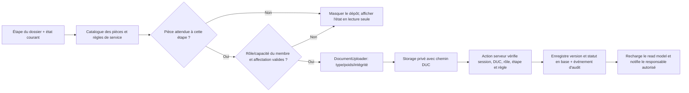

# Audit UI CFC de référence — Bl00dThirsty/cfc-housing-portal

**Date:** 2026-11-19  
**Comparaison locale:** `develop` à `fbc70cb` (le worktree local contient ensuite des changements non commités).  
**But:** retrouver les vues et interactions statiques à conserver, puis les relier aux sources et autorisations Supabase actuelles. Ce document n'autorise pas la reprise de données fictives ni des anciennes mutations en mémoire.

## Résultat de la recherche

Le dépôt de référence contient des idées d'interface utiles réparties entre `main` et plusieurs branches de fonctionnalité. Les branches ne forment pas un état produit unique et leurs exemples métier sont généralement des tableaux TypeScript statiques ou des modifications en `useState`. Elles doivent donc être lues comme des références d'interface, pas comme la source de vérité fonctionnelle.

Les interactions visuelles les plus directement réutilisables sont :

1. basculer le répertoire des emprunteurs entre cartes et tableau;
2. basculer le cabinet documentaire entre grille et liste;
3. garder un espace client cohérent avec une fiche dédiée, Kanban, DUC et carnet d'épargne;
4. afficher recherche, filtres à facettes, compteurs, aperçu et état de sélection sans cacher l'action principale.

Le code de référence ne démontre pas un téléversement métier réel par rôle : son dialogue dépose un `File` dans une URL `blob:` locale ou choisit un PDF statique, crée une référence aléatoire, puis ajoute l'objet au state React. Le tableau d'épargne et le Kanban suivent aussi un modèle local seulement. Ces morceaux ne doivent pas être repris pour autoriser une validation, une affectation ou une transaction.

## Carte des branches et décisions de portage

| Branche et commit observé | Motifs visuels/fonctionnels trouvés | Rapport à `develop` | Décision |
|---|---|---|---|
| [`main` — `6fc5cf1`](https://github.com/Bl00dThirsty/cfc-housing-portal/tree/6fc5cf12d5ec211a7440126d281a75a3d8a81c2d) | Portail public, simulateur d'épargne, inscription/KYC et console; source de départ des expériences | C'est un snapshot du prototype; il n'a pas les politiques métier/RLS du portail actuel | Garder les repères de contenu du portail public; vérifier chaque CTA contre les routes actuelles |
| [`feature/client-details-nike-redesign-dedicated-pages` — `a832f36`](https://github.com/Bl00dThirsty/cfc-housing-portal/commit/a832f368aaca76bd6f0717b5664f624feda6064) | Fiche emprunteur dédiée, section d'identité/finances, table de pièces et boutons d'action; répertoire cartes/tableau; DUC grille/liste | L'ancienne `clientsData` contient les fiches, documents, visas, valeurs financières, personnes affectées et pourcentages; le Kanban de la même famille inclut aussi un tableau de tâches fictif | Reprendre le découpage des sections, la hiérarchie des actions et les deux modes d'affichage. Remplacer chaque collection par le read model existant, sans conserver `data.ts` |
| [`feature/client-workspace-duc-kanban` — `856b360`](https://github.com/Bl00dThirsty/cfc-housing-portal/commit/856b3602b63472f31508584923c3931d5032a02a) | Espace emprunteur à quatre onglets : répertoire, Kanban, DUC, épargne; cartes avec checklist, pièces, commentaires, SLA et progression | L'espace par onglets existe déjà dans `ClientWorkspaceHub`; les tâches du Kanban sont définies dans le composant puis modifiées en mémoire | Conserver l'espace coordonné et les cartes détaillées. Faire venir les colonnes/étapes des catalogues et le détail des événements, checklist, commentaires et SLA des tables/RPC appropriés |
| [`feature/duc-real-documents-drag-drop-upload` — `b992db8`](https://github.com/Bl00dThirsty/cfc-housing-portal/commit/b992db8e54be0c65ac2cfd00175c6ce9a963fade) | Zone de dépôt drag/drop, aperçu PDF dans une fenêtre, impression/téléchargement; six PDF sont ajoutés à `public/documents` | Le code crée un `URL.createObjectURL(file)` ou choisit `getDocumentPdf(...)`; le parent garde les pièces dans `useState`. Aucune écriture Supabase n'est faite par ce flux | Reprendre l'aperçu drag/drop comme affordance seulement. L'octet doit passer par `DocumentUploader`/Storage privé; l'événement et les métadonnées enregistrés par l'action autorisée restent le résultat faisant foi |
| [`feature/guichet-unique-ui-refinement-filters-details` — `17e262e`](https://github.com/Bl00dThirsty/cfc-housing-portal/commit/17e262e9c503268de2bfd3484036ac3a7fad96ad) | Filtres facettés avec compteurs, fiches en vues dédiées et détails d'agence en panneau | Le filtre visuel peut s'appliquer aux query results actuels; les modèles d'agence et leurs transitions étaient liés à l'ancienne UI | Réutiliser les filtres et l'ouverture de détails en gardant les données de filtre dérivées de la requête autorisée et des catalogues présents |
| [`feature/login-rbac-sidebar-separation` — `f8acd03`](https://github.com/Bl00dThirsty/cfc-housing-portal/commit/f8acd037d1da3bd981a7eddf0a851c75abaefa08) | Sections de menu différentes par rôle et accès aux sous-applications | La séparation de navigation est utile; la branche contient également un sélecteur `allUsers/loginAsUser` qui permet de basculer entre comptes de démonstration | Reprendre le regroupement de navigation si utile, mais les capacités et autorisations actuelles restent déterminées par le profil serveur/RBAC. Aucun compte-switcher de démonstration en production |
| [`feature/portal-onboarding-simulator` — `541be04`](https://github.com/Bl00dThirsty/cfc-housing-portal/commit/541be04ff3fd9d45d6aac84cee0a67c57b5b59b6) | Entrée emprunteur, simulateur d'épargne et parcours KYC | Le portail client et le calculateur existent sur `develop`; l'ancien flux ne porte pas le nouveau contexte de demandes multiples ni la portée KYC exacte par DUC | Garder les libellés et étapes utiles; toute progression et tout calcul soumis doivent être liés au DUC sélectionné et aux règles/domain calculations présentes |
| [`feature/client-savings-passbook` — `4734724`](https://github.com/Bl00dThirsty/cfc-housing-portal/commit/473472420b0f90c1abeedea2c9b23331578b4d31) | Carnet avec solde, transactions, filtres par canal/type, pagination et aperçu de compte | Le composant référence `client.savingsPassbook`, puis met à jour `localTransactions` et `localBalance`; commentaire explicite : `no backend` | Réutiliser la densité et la navigation du relevé. Le solde, le crédit/débit, la validation et les annulations restent dans le ledger Postgres et ses actions/RPC transactionnelles |

## Matrice de couverture observée

| Surface | Référence | `develop` audité | Travail restant suggéré |
|---|---|---|---|
| Répertoire GESTIONNAIRE | Boutons « Cartes / Tableau », filtres phase/statut/agence et actions sur la fiche | `clients/page.tsx` alimente `ClientWorkspaceHub` avec résultats `getStaffDossiers`; les rôles non gestionnaires reçoivent une file métadonnées. Le répertoire n'expose pas le même contrôle cartes/tableau | Ajouter une préférence d'affichage accessible au-dessus des mêmes lignes déjà autorisées; les facettes/statistiques doivent être calculées depuis les résultats Supabase, sans états hardcodés |
| Cabinet GED du DUC | Grille/liste, recherche, filtre document, aperçu et chargement | `client-duc-manager.tsx` est un registre de pièces en lignes; recherche/catégorie et aperçu existent, pas de bascule grille/liste. Le dialogue actuel passe par `DocumentUploader`, le bucket privé et les types de pièces de la base | Ajouter la bascule grille/liste en réutilisant les mêmes pièces autorisées et le même callback d'aperçu; conserver téléversement, RLS et métadonnées existants |
| Parcours KYC | Identité, profession, documents, progression | KYC est déjà séparé en étapes et désormais scopé par DUC; le dépôt client utilise la checklist effective du catalogue | Vérifier la compatibilité clavier/mobile de la dropzone; afficher les règles de fichier et le motif de rejet à côté de la pièce qui doit être corrigée |
| Travail agence / gestionnaire | Répertoire, fiches, KYC, DUC, Kanban | Routes et capacités actuelles bornent les profils visibles; la page client masque les détails KYC aux rôles non assignés | Faire un audit des actions de réception/validation/rejet/complément pièce sur chaque étape; rendre visible le rôle autorisé et le motif; ne pas ajouter d'action générique « valider » |
| Risques & BET, comité, notaire/cadastre, décaissement, mainlevée | Menus/écrans de rôles dans les branches historiques | Plusieurs sous-routes actuelles sont des registres opérationnels ou des `PersistenceNotice` lorsque le schéma n'a pas de registre dédié | Pour chaque métier, établir un contrat « événement attendu → pièces requises → rôle responsable → décision → événement/notification ». Créer d'abord le registre/capabilité/RLS, puis l'écran |
| Épargne | Carnet et saisie de transaction | Ledger réellement persisté, capabilities de débit/crédit/validation/annulation présentes | Porter la hiérarchie du relevé et les filtres, puis lier chaque CTA à l'action contrôlée et à son événement; ne jamais calculer un solde client en état local comme source de vérité |

## Règles de portage des documents par rôle

Les branches de référence exposent une bibliothèque GED et un dépôt par un seul dialogue de console. Elles n'associent pas de façon fiable une action documentaire à un rôle, une phase, une affectation, un type de document catalogue ou une décision. Le fait de pouvoir voir « déposer » ne prouve donc pas l'autorisation.

Modèle à appliquer dans l'app actuelle :

Le serveur et Postgres doivent revalider les conditions au moment de l'écriture. Les choix de rôle/étape ne doivent pas être inférés d'une valeur de menu, d'un `user_metadata` modifiable, d'un chemin client, ou du simple fait que le dialogue est présent.

## Recommandations d'implémentation

1. **Conserver les détails véridiques de l'UI :** cartes/listes, facettes comptées, DUC en vue fichiers, étiquettes de phase, aperçu de document, quatre onglets de workspace.
2. **Partager le même read model entre les vues :** les modes carte/tableau/grille/liste ne font qu'afficher les mêmes résultats et n'ont pas chacun leur source ou leurs mutations.
3. **Réintroduire les affordances manquantes par petites tranches :** d'abord bascules table/cartes du répertoire et grille/liste GED; ensuite détails de chaque tâche par rôle après validation du workflow et de son registre.
4. **Ajouter des scénarios via les seeds de développement/staging :** emprunteur sans demande, KYC à corriger, plusieurs demandes actives, pièce absente/en attente/rejetée/validée, dossiers par région et manager, dossier orienté au notaire, décision de comité, échéancier et carnet avec opérations en attente/validées/annulées. Les identifiants doivent être liés aux acteurs et catalogues réels du seed; aucun écran n'importe la fixture directement.
5. **Garder les règles comptables et les transitions métier dans la base :** le prototype de passbook et les toggles de checklist ne sont pas des preuves d'un écrit durable. Ajouter tests d'isolation RLS et tests de rejeu/idempotence à chaque écriture.

## Suivi d'implémentation — 19 novembre 2026

Les quatre affordances de présentation qui manquaient sont désormais reliées aux read models actuels :

| Surface | Modes disponibles | Source et comportement vérifiés |
|---|---|---|
| Répertoire des emprunteurs | Cartes / tableau | `getStaffDossiers`; filtres, sélection et export suivent les résultats visibles |
| Cabinet DUC | Grille / liste | Pièces réellement autorisées du dossier; recherche/catégorie et ouverture restent communes aux deux modes |
| Files opérationnelles par rôle | Grille / liste | Projection sûre sous RLS; recherche et liens de détail restent identiques |
| Registres opérationnels persistés | Grille / liste | Même projection filtrée; les enregistrements restent liés à leur DUC quand disponible |

La couverture UI vérifie une recherche suivie d'un basculement en grille et confirme que les autres résultats ne réapparaissent pas. Le typecheck et la lint ciblée passent après ces changements.

Les pages des spécialistes ne doivent pas afficher un dépôt générique sur le seul fondement d'une permission de rôle. La base ne porte pas encore des identifiants d'affectation notaire/BET distincts, et les exigences documentaires par étape ne sont pas reliées aux phases du dossier par une référence. Le prochain slice métier doit créer ce lien autoritaire, faire appliquer la même règle par l'action serveur et RLS, puis ajouter les écrans d'upload/décision sur les dossiers affectés. Le modèle et le diagramme de séquence sont consignés dans la spécification de complétion système.

## Sources examinées

- [Dépôt upstream — `main`](https://github.com/Bl00dThirsty/cfc-housing-portal/tree/main) et commit `6fc5cf12d5ec211a7440126d281a75a3d8a81c2d`.
- Répertoire statique [`clients-table.tsx`](https://github.com/Bl00dThirsty/cfc-housing-portal/blob/a832f368aaca76bd6f0717b5664f624feda6064/src/app/admin/clients/_components/clients-table.tsx) et données [`data.ts`](https://github.com/Bl00dThirsty/cfc-housing-portal/blob/a832f368aaca76bd6f0717b5664f624feda6064/src/app/admin/clients/_components/data.ts).
- GED [`client-duc-manager.tsx`](https://github.com/Bl00dThirsty/cfc-housing-portal/blob/a832f368aaca76bd6f0717b5664f624feda6064/src/app/admin/clients/_components/client-duc-manager.tsx), dialogue [`duc-upload-dialog.tsx`](https://github.com/Bl00dThirsty/cfc-housing-portal/blob/a832f368aaca76bd6f0717b5664f624feda6064/src/app/admin/clients/_components/duc-upload-dialog.tsx), aperçu [`duc-add-document-dialog.tsx`](https://github.com/Bl00dThirsty/cfc-housing-portal/blob/b992db8e54be0c65ac2cfd00175c6ce9a963fade/src/app/admin/clients/%5Bid%5D/_components/duc-add-document-dialog.tsx) et visualiseur [`duc-pdf-viewer-modal.tsx`](https://github.com/Bl00dThirsty/cfc-housing-portal/blob/b992db8e54be0c65ac2cfd00175c6ce9a963fade/src/app/admin/clients/%5Bid%5D/_components/duc-pdf-viewer-modal.tsx).
- Kanban [`client-kanban.tsx`](https://github.com/Bl00dThirsty/cfc-housing-portal/blob/856b3602b63472f31508584923c3931d5032a02a/src/app/admin/clients/_components/client-kanban.tsx), workspace [`client-workspace-hub.tsx`](https://github.com/Bl00dThirsty/cfc-housing-portal/blob/856b3602b63472f31508584923c3931d5032a02a/src/app/admin/clients/_components/client-workspace-hub.tsx), passbook [`client-savings-passbook.tsx`](https://github.com/Bl00dThirsty/cfc-housing-portal/blob/473472420b0f90c1abeedea2c9b23331578b4d31/src/app/admin/clients/_components/client-savings-passbook.tsx).
- Filtres et détails [`agency-dossier-details-sheet.tsx`](https://github.com/Bl00dThirsty/cfc-housing-portal/blob/17e262e9c503268de2bfd3484036ac3a7fad96ad/src/components/admin/agency-dossier-details-sheet.tsx); séparation des menus [`admin-sidebar.tsx`](https://github.com/Bl00dThirsty/cfc-housing-portal/blob/f8acd037d1da3bd981a7eddf0a851c75abaefa08/src/components/admin/admin-sidebar.tsx).
- Portail public/KYC [`src/app/onboarding/page.tsx`](https://github.com/Bl00dThirsty/cfc-housing-portal/blob/541be04ff3fd9d45d6aac84cee0a67c57b5b59b6/src/app/onboarding/page.tsx), dropzone historique [`src/components/portal/document-dropzone.tsx`](https://github.com/Bl00dThirsty/cfc-housing-portal/blob/541be04ff3fd9d45d6aac84cee0a67c57b5b59b6/src/components/portal/document-dropzone.tsx).
- Équivalents actuels inspectés : `src/app/portail-cfc/(console)/clients/page.tsx`, `src/app/portail-cfc/(console)/clients/_components/client-workspace-hub.tsx`, `client-duc-manager.tsx`, `duc-upload-dialog.tsx`, `src/components/portail-cfc/operational-register-view.tsx`, et `src/components/portail-client/document-dropzone.tsx`.
