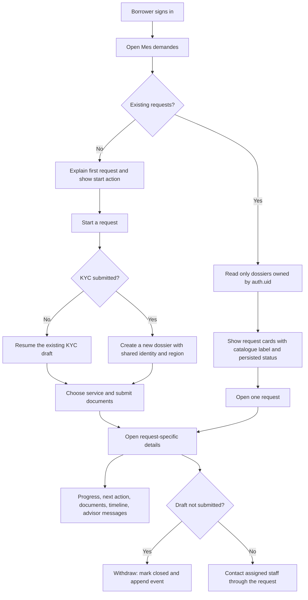
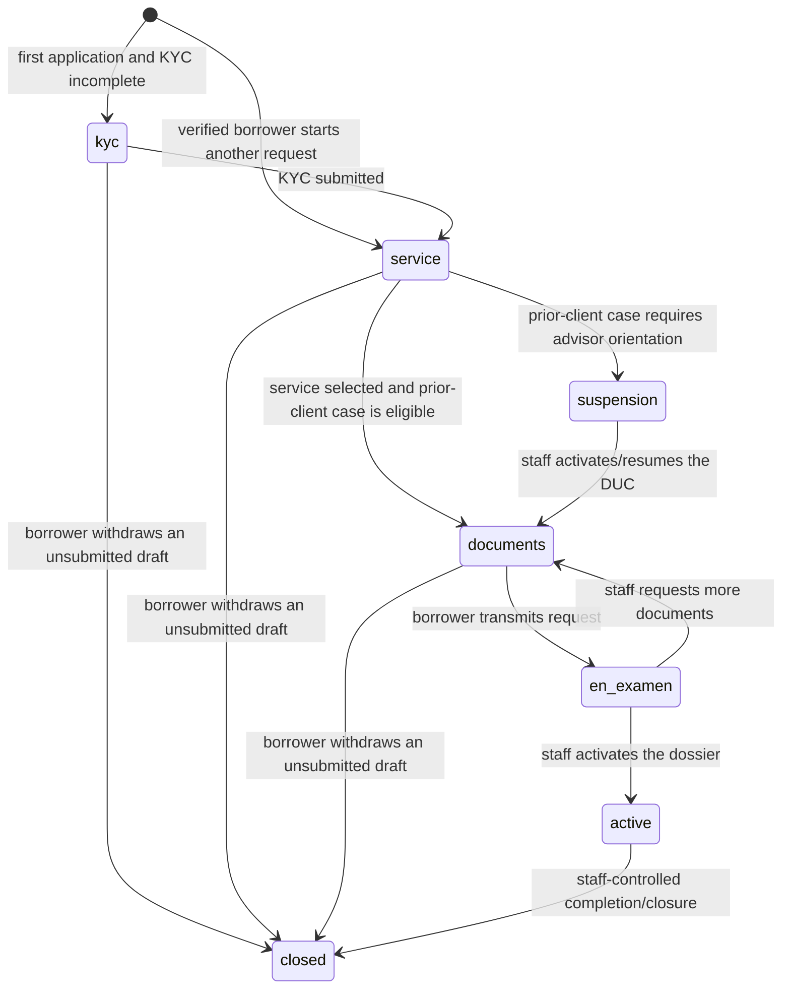
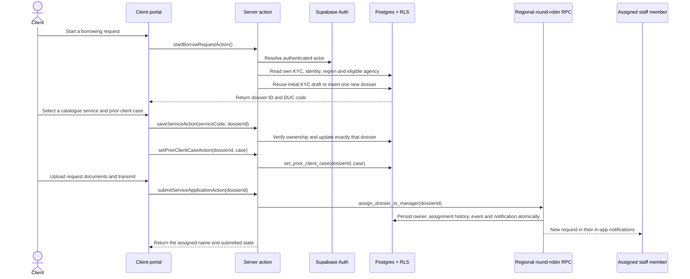
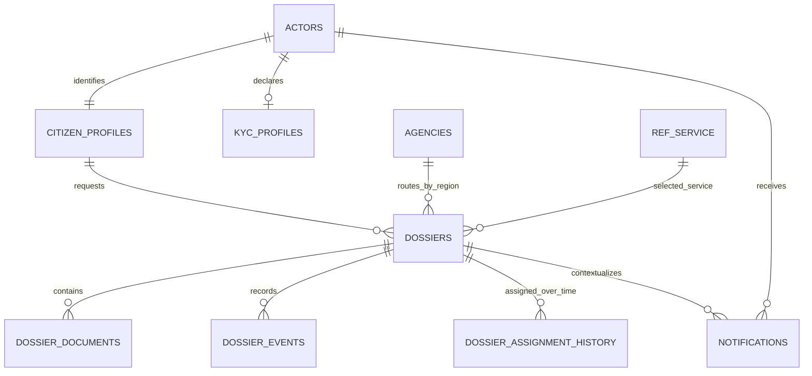

# Borrower Request Management

**Date:** 2026-11-18  
**Status:** Implemented on `develop`; local integration verification passed. Production/staging rollout remains out of scope.  
**Scope:** A database-backed client area to create, follow, and manage several borrowing requests without crossing data between dossiers.

## Product outcome

An authenticated borrower can open a portfolio of their own requests, start another request while existing requests remain active, resume an unfinished request, and open a request-specific workspace for its progress, documents, notifications, and advisor conversation. Each request is an independent dossier with its own DUC code, service selection, documents, events, and staff assignment. The borrower's identity/KYC declaration remains a shared actor profile and is reused only according to its persisted verification state.

No application card, service, phase, progress, advisor, or document requirement is synthesized from demo data. Request records come from `public.dossiers`; service and workflow labels come from the configured Supabase reference catalogue; assigned staff comes from the dossier and assignment records. Local and staging fixtures belong in database seeds, never in page components or production seed runs.

## Research and existing implementation

- The official [CFC practical guide for the classic property loan](https://creditfoncier.cm/fr/guide-pratique-pret-foncier-classique.html) describes a dossier workflow with intake, document/payment steps, instruction, decision, and offer/notification. The portal should expose request status and next required action without implying an approval before the corresponding staff decision exists.
- The official [borrower guide PDF](https://www.creditfoncier.cm/fr/component/phocadownload/category/5-le-guide-de-l-emprunteur.html?download=3%3Aguide-pret-foncier-classique) also separates instruction from the decision and subsequent loan setup.
- [Supabase Row Level Security documentation](https://supabase.com/docs/guides/database/postgres/row-level-security) recommends explicit per-operation policies using `auth.uid()`, ownership checks on inserts/updates, indexes for policy filters, and database policy tests. This feature will preserve the existing dossier RLS boundary and test cross-borrower isolation.
- The current `/portail-client` read model, `getCitizenSpace`, selects only the newest dossier. `saveServiceAction`, `set_prior_client_case`, `submit_service_application`, `loadOnboardingDraft`, `loadOnboardingState`, and `saveKycDraftAction` also choose the newest dossier in at least one place. A portfolio UI alone would therefore let an action on an older request mutate a different request.
- `public.dossiers` already models one request per row, with unique DUC codes, `citizen_id`, `service_code`, workflow state, and references to documents, events, assignments, and notifications. `kyc_profiles` is keyed by citizen, so KYC declarations are actor-wide today.
- Regional assignment is implemented by `private.assign_dossier_to_manager(uuid)`. It requires a dossier agency whose region matches an active GESTIONNAIRE and atomically writes assignment history, a dossier event, and an in-app notification. A new request must carry a valid database-backed `agency_id` before staff assignment; an unavailable region must produce an actionable error, not a fabricated advisor.

## Product decisions

1. **Several active requests are allowed.** Each click to start a request creates or resumes one explicit draft dossier. A borrower can keep other requests open or in instruction in parallel. At most one credit contract may be active after approval; open requests and offers do not count as active contracts. Contract activation needs a durable contract record and a database concurrency constraint, which are not yet implemented.
2. **The dossier ID is mandatory context for request mutations and detail reads.** Server actions never infer the target by ordering `created_at`.
3. **KYC is shared and stateful.** A borrower with a persisted KYC submission skips the identity/KYC wizard on later requests and reuses the verified profile. A borrower with no submitted KYC continues the existing first-request wizard. A request never re-submits already-submitted KYC as a side effect.
4. **Requests are not hard-deleted.** A borrower may withdraw a draft before it is transmitted; withdrawal closes the request and appends a dossier event. Once submitted, the borrower contacts the assigned staff through that request's conversation for withdrawal handling.
5. **Catalog data controls the application.** Service, required document, process step, phase, and advisor data are read from Supabase. Stable state codes may be translated by the UI, but no example requests, advisor names, or fallback request records are embedded in the UI.
6. **The CFC visual system remains.** Use existing cards, badges, tabs, dialogs, buttons, spacing, and typography. Add request-specific details and helpful next-action/empty states without a redesign.

## User journeys

### Request portfolio

### State lifecycle

Existing staff state transitions remain platform controlled. The client-facing action for `closed` is limited to draft withdrawal. It does not let a client set `active`, change the assignment, or edit staff decisions.

### Create and submit sequence

## Domain and data ownership

| Data | Owner | Request behavior |
|---|---|---|
| Auth identity and contact | Auth / `citizen_profiles` | Shared across the borrower's requests |
| KYC declarations and submission | `kyc_profiles` / `citizen_profiles` | Shared; later requests reuse verified values |
| DUC code, service, workflow state, agency, project/financial copies | One row in `dossiers` per request | Independent request aggregate |
| Documents, timeline, conversations, assignment, request notifications | Dossier ID | Must be scoped to the selected dossier |
| Services, process phases/steps, document requirements, agencies, staff | Supabase database catalog | Read from persisted, effective rows |

## Authorization matrix

| Actor | List/read a request | Create | Upload documents | Withdraw | Change workflow or assignment |
|---|---|---|---|---|---|
| Borrower | Own dossiers only | Own actor only | Own selected dossier only | Own, before submission only | Never |
| Assigned GESTIONNAIRE | Assigned scope under existing capabilities | No | Existing staff rules | No | Existing staff decisions only |
| ADMIN | Existing capabilities | Existing admin rules | Existing capabilities | No client impersonation | Reassign through the existing audited manual path |
| Other borrower/staff | No access unless existing capability grants the exact record | No | No | No | No |

Every server action authenticates through the session, checks the target dossier belongs to the current citizen, and then passes that dossier ID into a narrow database operation. RLS remains the final guard. The detail route returns not-found for a foreign or missing dossier so identifiers do not reveal existence.

## UI requirements

- Add **Mes demandes** to client navigation and a visible **Nouvelle demande** action.
- Provide an informative zero-state, loading/error state, and cards sourced from the borrower's actual dossiers.
- Each card shows DUC code, catalogue service label, status, current phase/progress when persisted, opened/updated date, and a clear next action.
- The request workspace is addressable by dossier ID and shows the existing dashboard, timeline, request-specific checklist and upload, and the conversation anchored to this dossier.
- Show unfinished, paused, under-review, active, and closed requests distinctly using current CFC tokens. Give concise tooltips/field help for technical state transitions and what the borrower should do next.
- A draft can be withdrawn only after a confirmation dialog states that its DUC and history remain retained and that a new request can be started separately.
- If no agency/active regional GESTIONNAIRE can be derived for the borrower's stored region, leave the request unsubmitted and explain the missing routing configuration. Do not select a fake advisor.
- The new-request path for a KYC-submitted borrower starts at service selection. It does not show editable verified identity fields or attempt a second KYC submission.

## Architecture and invariants

- `getCitizenSpace(userId, dossierId)` reads one explicit dossier when an ID is supplied; the list query is separate and RLS-scoped.
- `loadOnboardingDraft(dossierId)` reads the given owned dossier plus shared citizen/KYC records. It never returns a different dossier as fallback when a requested ID is invalid.
- Request actions use explicit `dossierId`: service selection, prior-client case, submission, withdrawal, and notification lookup.
- SQL functions use `auth.uid()` to prove the selected dossier is the caller's and lock that row before changing state. Functions no longer select the newest request.
- Before request creation, derive the agency from the persisted profile region and live agency catalogue, considering only routable agency regions. For non-resident profiles, use configured diaspora desk records and a region with an active GESTIONNAIRE; if none exists, return a controlled routing error.
- Withdrawal is an audited state transition: `status = 'closed'`, `closed_at`, and a `REQUEST_WITHDRAWN` dossier event are written in one transaction. No row or evidence is deleted.
- User-facing labels for products, process phases, steps, and document rules are read from Supabase. New fixed event/state codes are protocol values with localized UI text, not fixture business content.

## Test and fixture requirements

- Unit tests cover request status presentation, draft-withdraw eligibility, and agency selection from agency/manager records.
- Server-action tests prove unauthenticated rejection, foreign dossier rejection, and exact-ID forwarding for service choice, prior-client case, submission, and withdrawal.
- pgTAP tests prove a borrower can own multiple dossiers, cannot read or mutate another borrower's dossier, can withdraw only an unsubmitted own request, and cannot withdraw a transmitted dossier.
- A local end-to-end journey creates two concurrent requests, submits one, leaves one draft, reloads both detail pages, uploads to one, and confirms the other dossier did not change.
- Local/staging seed fixtures cover no-request, one incomplete KYC request, multiple active products, a paused request, a submitted request with missing documents, an active request, and a closed request. Production must not seed demo clients, staff, requests, or documents.

## Out of scope for this slice

- Changing official CFC loan eligibility or committee rules.
- Client edits to an assigned or submitted application's core terms.
- Client self-reassignment, staff impersonation, hard deletion, or approval/activation.
- Replacing the shared KYC data model with per-request KYC snapshots. If legal retention requirements later require immutable KYC snapshots, that should be designed as a separate audited data-model change.

## Implementation record

- `GET /portail-client/demandes` now renders the authenticated borrower's persisted request portfolio; `GET /portail-client/demandes/[id]` reads one explicitly selected dossier and returns not-found for missing or unowned IDs.
- The request list and workspace read models live in `src/server/queries/borrower-requests.ts` and `src/server/queries/citizen-space.ts`. Shared view contracts are in the domain layer so client components do not import server query modules.
- Request creation, service selection, prior-client routing, submission, withdrawal, KYC draft/submission, document uploads, and detail reads carry the exact dossier ID. A KYC-incomplete first request is resumed; an already-submitted client can create additional independent requests.
- Forward migrations `20261119094613_borrower_request_management.sql`, `20261119100613_kyc_submission_request_scope.sql`, and `20261119102429_profile_multi_request_consistency.sql` provide explicit-ID ownership checks and lifecycle transitions. They were applied to the local stack only.
- Regional round-robin assignment remains database-backed. Assignment writes the staff notification; changing a request to `DOCUMENTS_READY` or `APPLICATION_SUSPENDED` also dispatches an idempotent borrower notification from the server action.
- The local Supabase end-to-end onboarding/request journey passed (2 tests). Borrower request pgTAP passed (21 assertions). The full Vitest suite passed (448 passed, 17 environment-gated skips), `npm run test:system` passed (40), and typecheck, ESLint, and production build passed.
- Remaining product work belongs to the broader platform-completion roadmap: audit other staff/client pages for legacy mock data, test the full set of seeded workflow fixtures, and verify mobile/browser behavior. No hosted database was linked, migrated, or seeded.
