# CFC Housing Portal — System Completion Design

**Date:** 2026-11-18  
**Status:** Core bootstrap, assignment/KYC boundaries, database-backed queues, aggregate analytics, and the first savings-ledger controls are implemented on `develop`; broad route completeness and final verification remain in progress.  
**Scope:** Reproducible local/staging/production operations, authoritative database-backed screens, staff assignment and KYC privacy, savings passbook, and user-facing guidance.

## 1. Product outcome

The portal should present one trustworthy picture of CFC operations in every environment. A client, staff member, administrator, or dashboard must see records that exist in the selected Supabase environment. Sample people, accounts, dossiers, events, and transactions are permitted only in explicitly seeded local or staging environments. No operational page may silently substitute an in-memory demo record when the database is empty or unavailable.

The first objective is to make the application installable and understandable for a colleague who clones it, safe to connect to cloud projects, and consistent about who owns each client dossier. The same foundation then supports real KYC decisions, notifications, and a savings ledger.

## 2. Research and current audit

The design follows Supabase CLI 3.x: migrations are the schema source of truth, local stack and seed data are reproducible, and remote pushes have an explicit target. `supabase` is pinned to 3.2.0. Database commands default to the local stack; all hosted writes in the orchestrator include `--remote=<project-ref>`. Remote push previews run before the mutation; the CLI's operator confirmation is retained and the orchestrator does not pass `--yes`. Supabase documents hosted seed inclusion for development/staging, not production. RLS is the data authorization boundary; authenticated status alone does not establish row ownership. Security notification email paths use a different relative path convention from auth message templates. The existing UI uses Radix primitives and a shadcn-style component layer, so help affordances should reuse that layer instead of introducing a second design system.

Current repository findings (implementation snapshot):

- The app uses Next.js server components/actions, Supabase SSR, Postgres migrations, private Storage, and role-aware route groups. `supabase/seed.sql` supplies reference catalogues; Auth-linked local/staging identities and business fixtures are created separately by the guarded Node seeder.
- `npm run system:local`, `system:staging`, and `system:production` are implemented with the pinned Supabase CLI 3.2.0. Local startup reads the stack keys privately, applies migrations without reset, seeds local accounts, and starts Next.js. Staging and production require explicit distinct refs; only staging may seed fixtures. Hosted migration commands are explicit and retain the CLI confirmation.
- System scripts load development-mode env files while preserving variables supplied by the caller. The local seeder prioritizes the local Supabase service-role credential over a generic cloud secret key, so local CLI credentials cannot be shadowed by an unrelated secret in the environment.
- The password-changed notification template uses the correct Supabase-relative path. Template/config validation and secret-safe environment-resolution tests are in the system test suite.
- The former demo adviser list and hash-based distribution are replaced by a database-managed regional GESTIONNAIRE roster, locked regional round robin, assignment history, reasoned admin reassignment, and a notification committed with the assignment. Eligibility currently means an active account with a current GESTIONNAIRE assignment at an agency in the dossier region; leave and caseload capacity are not yet modeled. Local/staging fixtures contain staff identities; production identity provisioning remains a real-account operation.
- KYC profile/evidence reads and decisions are scoped to the citizen or the currently assigned regional GESTIONNAIRE. Queue/detail projections for administrators and other staff contain safe dossier metadata; they do not include KYC profile fields. RLS and Storage policies are part of the boundary, not just component visibility.
- Central role and agency resolution now honors each staff assignment's start/end validity window. Profile, landing, and client auth-context reads use the same active-window rule; local pgTAP cases reject expired and future assignments.
- The savings passbook reads persisted accounts/transactions; submission, approval, rejection, and full compensating reversals use transaction-safe database functions. The database controls balances and maintains the ledger. Exhaustive financial concurrency and reconciliation coverage remain follow-up items.
- Client queues, Kanban, dossier details, analytics, and actor workspaces no longer substitute demo records. Both Kanban views load phase codes, labels, and order from `cfc_process_phases`; a missing catalogue is surfaced as an error/empty state. Analytics uses one security-invoker RPC that returns aggregates. Supported actor registers read existing tables under RLS. Where no persistence schema or workflow exists yet, the page states that explicitly rather than displaying invented records.
- The borrower progress tracker and analytics labels now read phase and step catalogues from Supabase. Email-template preview fields are blank until staff enter preview values; fictional customer identities and amounts are not supplied by the editor.
- The local stack is available for verification. Migrations through `20261118190000` have been applied locally. Local pgTAP coverage currently passes 14 tests. No hosted migration, production seed, or cloud data cleanup has been run.
- Next's cached production webpack resolver retained a request for the removed notary mock component. Source imports were clean; `npm run build` clears only stale production webpack caches before compilation and leaves active development caches untouched.
- Local and staging dev startup now clears the project-owned `.next` output immediately before launching Next. This rebuilds client/server Webpack manifests and HMR chunks together after branch changes; the cleanup test confirms sibling files such as `.tmp-build-check` are untouched. The tooltip source export and installed Radix provider exports resolve correctly, and the clean build plus local route smoke checks pass.

The implementation is still a foundation, not a claim that every menu route is a complete business workflow. The route inventory below distinguishes persisted registers from modules that still need an approved schema and CRUD/decision flow. A codebase-wide fixture scan and route-by-route UI review remain release checks.

The commercial-counter lifecycle and the administration surface are now documented separately in [the commercial workflow specification](2026-11-19-commercial-counter-workflow.md) and [the admin governance specification](2026-11-19-admin-governance-console.md). The latter records current view toggles, the missing admin routes, secure account recovery, SMTP secret boundaries, and the local/staging fixture coverage contract. These documents refine this system-completion design and do not mark unfinished workflows as implemented.

## 3. Design choices

### Recommended approach: phased vertical slices

1. **Bootstrap and environment safety:** fix the template path and key loading, pin the Supabase CLI, and add local/staging/production commands with distinct target guards.
2. **Ownership and privacy:** finish the existing staff-assignment WIP, add transactional region round robin and assignment history/notifications, then enforce ownership at the database boundary and in server actions.
3. **Database-backed operations:** replace console fixtures with queries for real clients, dossier lists, Kanban, staff, and dashboards; represent loading, empty, and error states honestly.
4. **Savings and polish:** make the passbook a validated, auditable ledger; add contextual guidance, accessible tooltips, and page-specific empty-state actions.

This sequence establishes safe data and access boundaries before making the rest of the interface depend on them. A broad UI rewrite would obscure whether each page is actually correct; a backend-only rewrite would leave the colleague-facing inconsistencies in place.

## 4. Architecture

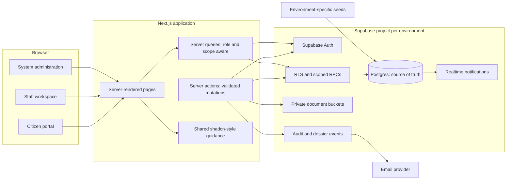

### System boundaries

- **Browser:** display authorized data, submit user intent, and subscribe to the signed-in user's notifications. It never receives the service-role/secret key.
- **Next.js query layer:** load data with the signed-in server Supabase client. A query returns typed records or a surfaced error; it must not turn an error into demo data or an empty success.
- **Next.js action layer:** validate input, resolve the signed-in identity and role from trusted server/database state, call a narrow database function for multi-row invariants, and report a stable result to the UI.
- **Postgres:** owns identity links, staff eligibility/region, dossier assignment, KYC access, savings balances/ledger facts, notifications, and audit history. RLS protects direct Data API access; narrowly scoped RPCs handle atomic transitions.
- **Storage:** KYC and dossier evidence remains private and follows the same dossier ownership checks as its metadata. Download links are short-lived and generated only after authorization.
- **Email:** secondary delivery channel. In-app assignment notification is persisted with the assignment so an email failure cannot erase the work queue signal.

### Data relationship model

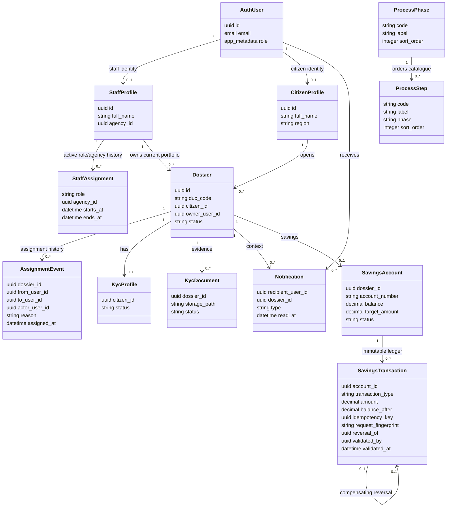

The classes describe the implemented core and the intended financial profile. Staff eligibility is derived from a current `staff_assignments` row and the agency region; there is no independent leave/capacity flag yet. Add future workflow fields through forward-only migrations and preserve production migration history.

## 5. Operational workflows

### Local startup

```mermaid
sequenceDiagram
  actor Dev as Developer
  participant Cmd as npm run system:local
  participant Node as Setup orchestrator
  participant CLI as Supabase CLI
  participant DB as Local Supabase
  participant Seed as Guarded local user seeder
  participant App as Next.js dev server

  Dev->>Cmd: Start the system
  Cmd->>Node: Load local env without printing secrets
  Node->>CLI: Check pinned CLI and Docker prerequisites
  Node->>CLI: supabase start
  CLI->>DB: Start local services and apply pending setup
  Node->>CLI: Apply pending local migrations without reset
  Node->>Seed: Seed idempotent dev identities and fixture records
  Seed->>DB: Require loopback URL + local secret key
  Node->>App: Start Next.js with local public URL/key
  App-->>Dev: Portal ready; local Supabase remains running
```

**Command contract:** `system:local` installs declared Node dependencies if absent, verifies Docker and the pinned CLI, starts the local stack, applies pending migrations without resetting the database, loads `.env.local` privately, idempotently seeds local-only test identities/data, clears the generated `.next` output, and runs the app. It never links a hosted project. `db:reset` remains a separate explicitly destructive command.

### Staging and production

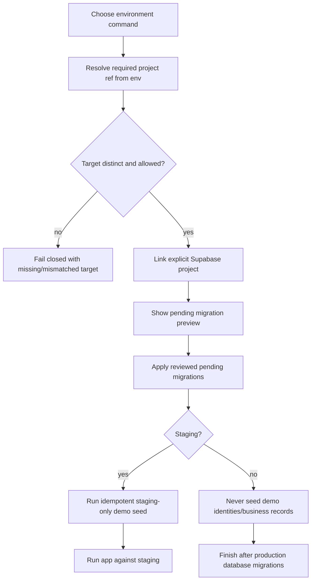

| Command | Target requirements | Schema/data behavior | App behavior |
|---|---|---|---|
| `npm run system:local` | Docker, pinned Supabase CLI, `.env.local` public and local secret keys | Start local stack; apply pending migrations without reset; guarded local identities and fixtures | Run Next.js against loopback |
| `npm run system:staging` | Staging ref, distinct production ref, stage URL/keys, scoped Supabase access and DB credentials | Link the staging ref; preview/push migrations including `seed.sql`; then seed staging-only identities | Clear generated `.next` output, then run Next.js against staging config |
| `npm run system:production` | Production ref/URL/public key, access token and DB credentials | Link the production ref; preview/push migrations after the CLI's confirmation; no demo users/records | Prepare production database only; hosting deployment remains a separate provider workflow |

Staging and production refs are environment configuration, never fixture constants. The staging command refuses a missing ref, a ref equal to production, or an HTTPS URL whose host does not exactly match the configured ref. Every remote database command includes the chosen explicit ref so a stale local link cannot redirect a migration. The CLI project link is also explicit. Production never passes `--include-seed`, invokes a fixture seeder, or resets the remote database. `system:production` does not build the app because deployment is independently controlled by the hosting provider; the current repository has a Vercel production URL but no deploy command/credential contract in the system orchestrator.

The orchestrator loads `.env.local` as a private input and does not print its contents. The production Supabase CLI subprocess receives the production access token and database password, but no local or staging service key. The staging service key is passed only to the staging fixture seeder; the staging CLI receives no application service key. The Next.js app subprocess receives the selected environment's URL and public key. The local Supabase CLI telemetry setting is disabled for the child process only when the caller has not already set it, avoiding a profile write in restricted development environments.

### Region-based assignment and notification

```mermaid
sequenceDiagram
  actor Client
  participant App as Onboarding action
  participant DB as Assignment RPC / Postgres
  participant Staff as Eligible regional staff
  participant Inbox as In-app notification
  participant Admin as Assignment administration

  Client->>App: Submit dossier / onboarding step
  App->>DB: Submit dossier transition
  DB->>DB: Resolve dossier's authoritative region
  DB->>DB: Lock region cursor and choose next active regional GESTIONNAIRE
  DB->>DB: Save owner + assignment history + in-app notification atomically
  DB-->>App: Assigned staff identity or unassigned reason
  DB-->>Staff: Realtime notification with dossier link
  alt No eligible staff in same region
    DB->>DB: Keep dossier explicitly unassigned
    DB-->>Admin: Notify the admin assignment queue
  end
  opt Authorized administrator reassigns
    Admin->>DB: Reassign with selected staff and mandatory reason
    DB->>DB: Check target region/eligibility; append audit history
    DB->>DB: Notify new assignee and record actor/reason/time
  end
```

Round robin is a stored, per-region rotation serialized by a locked cursor row. Eligible staff have an active account, a current `GESTIONNAIRE` role assignment, and an agency in the dossier's configured region. The ordering is deterministic and fairness is based on the persisted region cursor, not a hash of the citizen ID. The current schema has no leave or caseload-capacity flag, so "available" currently means active in that role/agency assignment. If nobody qualifies, keep the dossier out of a different region and expose the assignment failure to the authorized queue. Admin reassignments require an eligible same-region target and a reason, and append rather than overwrite assignment history.

The database transaction commits assignment, audit history, and a durable in-app notification together. Email is attempted after commit. The assigned staff member gets a link to the dossier; notification payloads contain no identity-document data. Realtime improves latency but the persisted notification list remains the source of truth.

### KYC viewing and decision boundary

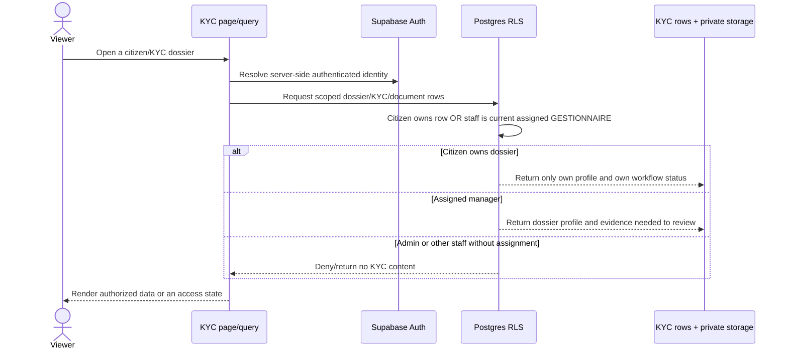

| Actor | KYC profile/evidence | Assignment metadata | Reassign |
|---|---|---|---|
| Citizen | Own profile and own submitted evidence/status | Own dossier's assigned state only as product policy permits | No |
| Assigned GESTIONNAIRE | Read/review and decide own assigned dossier, subject to capability | Own portfolio | No |
| Other staff | No KYC content unless a separately defined workflow grants it | Only workflow-specific dossier summary | No |
| System admin | No KYC profile fields or evidence | Staff eligibility, region, assignment history, unassigned queue | Yes, with reason and audit event |

Authorization is checked in both the server action/query and RLS (and storage policies). Removing access in the UI is not authorization. Role claims must come from trusted database or server-managed app metadata, never user-editable metadata. Assignment changes invalidate the former manager's access immediately at the next database request; short-lived signed document links and session policy must be reviewed so a stale URL does not extend access.

### Carnet d'Épargne / savings ledger

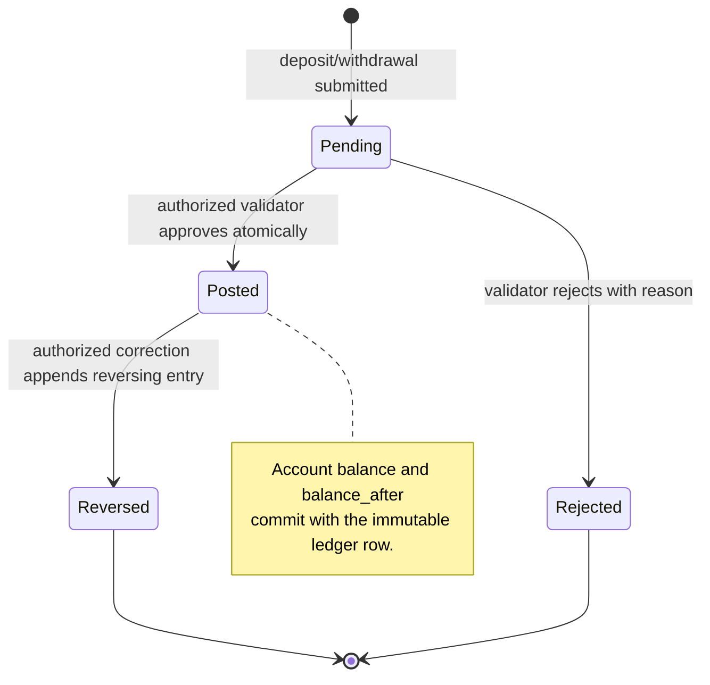

The passbook reads the account and ordered transactions from Supabase. A server action validates amount, type, channel, reference, currency, dossier scope, and idempotency key; a database function locks the account and appends the transaction with its resulting balance. Pending operations do not change the posted balance. An authorized validator posts or rejects; correction of a posted transaction is an auditable reversing entry, not edit/delete. The server never trusts a client-supplied balance. Statements/export/print are derived from authorized persisted ledger rows. The UI shows who entered/validated a row, when, reference, channel, status, and a clear validation trail.

```mermaid
sequenceDiagram
  autonumber
  actor Teller as Authorized staff
  participant UI as Passbook UI
  participant Action as Server action
  participant DB as Postgres savings RPC
  participant Audit as Dossier event log

  Teller->>UI: Enter deposit or withdrawal
  UI->>UI: Bind UUID to this form intent
  UI->>Action: Submit fields + idempotency key
  Action->>DB: record_savings_transaction
  DB->>DB: Lock account; check scope and capability
  alt Same key and same request
    DB-->>Action: Return original transaction ID
  else Same key with changed request
    DB-->>Action: Reject idempotency conflict
  else New request
    DB->>DB: Append pending row + request fingerprint
    DB->>Audit: Append transaction-recorded event
    DB-->>Action: Return new transaction ID
  end
  Action-->>UI: Pending or actionable error
  Teller->>UI: Independent validator approves
  UI->>Action: Validate transaction
  Action->>DB: decide_savings_transaction
  DB->>DB: Lock account + pending row; post balance atomically
  DB->>Audit: Append validation event
  DB-->>UI: New persisted balance
  Teller->>UI: Authorized checker enters correction reason
  UI->>Action: Reverse original + stable request key
  Action->>DB: reverse_savings_transaction
  DB->>DB: Check scope, role, maker-checker and prior reversal
  DB->>DB: Append linked inverse entry; update balance
  DB->>Audit: Append reversal event
  DB-->>UI: Linked reversal ID
```

Each submission intent keeps the same UUID across network retries. A changed form payload receives a fresh UUID. The database stores a fingerprint of the normalized intent and has a partial unique key per account, so a duplicate returns the original row while reuse with different values fails. A manual reference remains an independent provider/business duplicate check. Reversal is a full compensating entry only: it must name a reason, be performed by a different actor than the original maker, and can occur only once per source row. The original remains validated and immutable; the UI presents both references. Partial reversal and arbitrary adjustment types remain out of scope until Finance defines their accounting treatment.

### Operational state and dashboard pages

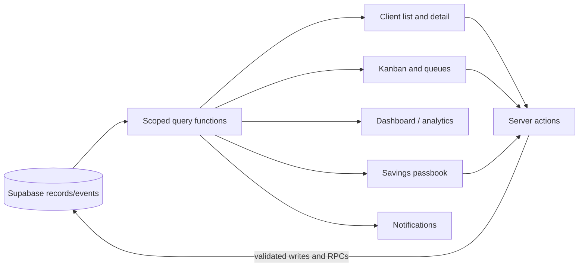

Lists, detail pages, Kanban cards, counters, charts, and notification badges must derive from the same persisted records/events and current access scope. Loading, empty, and failure states are distinct: a query error must be visible and logged with a correlation ID; an empty database must show an actionable empty state, not invented clients. Charts must disclose their source period and filters, and their totals must agree with the corresponding list/query.

## 6. No runtime mock data contract

### Allowed in source control

- UI labels, help text, route definitions, permissions/capability identifiers, form schemas, and deterministic calculation rules.
- Static reference/catalogue definitions only when they are versioned database seed inputs and the UI reads the stored/current effective version from Supabase.
- Local/staging-only fixture manifests and test factories that are not imported by production routes or runtime bundles.

### Not allowed in operational runtime code

- Sample names/emails, sample client/dossier IDs, fake document lists, demo staff rosters, fabricated balances/transactions, fake Kanban tasks, or static KPI series.
- A fallback such as `queryResult || clientsData`, hard-coded selected client, optimistic local passbook rows treated as persisted facts, or silent success when a Supabase query fails.
- Environment-specific project refs, passwords, service keys, or staff identities embedded in pages or server code.

### Required page contract

Every data-bearing page uses a server query with authenticated scope and a typed result. Client components receive serialized query results and call server actions for mutations. Pages expose loading, empty, forbidden, and error states; they do not invent records. Static lookup enums that must be shared by TypeScript and Postgres are generated/validated against the database catalogue. Fixture seeding is explicit, idempotent, restricted by target URL/project ref, and reports counts without printing secrets.

### First-pass hardcoded catalogue audit (incomplete)

The runtime fixture scan found no remaining `DEMO_*`/`MOCK_*` operational collections or the deleted `DEMO_ADVISORS` roster. It did find code-owned reference and policy values that are not fake client records but still need a single database source before the no-hardcoding acceptance criterion is met:

| Source | Current values | Required follow-up |
|---|---|---|
| `src/domain/entities/kyc.ts` / `src/server/queries/kyc-options.ts` | Family, employment, income, identity-document, housing-occupancy, and PEP options | **Completed locally:** values live in versioned `ref.kyc_option` seed rows; the onboarding route reads `public.cfc_kyc_option`; the submission RPC rejects values that are not currently effective. Stable category identifiers remain in TypeScript because they define the KYC JSON field contract. |
| `src/domain/entities/kyc-profile.ts` | Three KYC document codes and labels | Derive required KYC evidence from the existing effective `ref.document_type` catalogue and avoid a second document list. |
| `src/domain/entities/onboarding.ts` | Affiliation descriptions and policy consequences | Persist editable labels/help and consequence codes; keep consequential eligibility logic in database-backed policy/action code. |
| `src/domain/entities/address.ts` | Cameroon place/region/chef-lieu suggestions | Move the curated offline place catalogue into versioned seed data, then read it from a restricted public view; record its authoritative source and update cadence. |
| `src/domain/workflows/recovery.ts` | Arrears stages, month thresholds, obligations, procedure references, and SLAs | Obtain Recovery/Legal ownership, model the lifecycle and policies in the database, then replace the incomplete client-side policy list. |
| `src/domain/entities/services.ts` and `src/server/queries/pole-kpis.ts` | Requirement-stage labels and state-group filters | Reconcile against workflow/reference catalogues and use database-owned stage/state groupings where they affect eligibility or reported counts. |
| `src/server/email/defaults.ts` and `src/server/email/templates.ts` | Template definitions used by a publish script and as runtime fallbacks | Keep one canonical template seed source; runtime sends and editor rows must fail visibly when the seeded, effective database template is absent. |
| `src/domain/policies/permissions.ts` | UI capability map paralleling `ref.role_capability` | Have the session context read the effective capability catalogue; SQL remains the authorization boundary and the UI must not maintain a second decision matrix. |
| `src/server/queries/staff-dossiers.ts` and savings forms | Status translations and operation-channel choices | Compare with database state/channel catalogues; keep localized display strings separate from allowable values. |

The Kanban phase arrays were a duplicate of the database-owned process phases and have now been removed from both views. The first-pass scan is evidence for the backlog, not proof that all routes and constants have been audited. Empty/unavailable reference data must stay visible as an error or empty state:

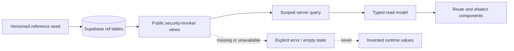

KYC choices follow the same contract. Seeded values preserve the legacy stored codes, while labels can evolve independently. Expired or deleted choices disappear from the form; the submission RPC checks the persisted code again, so a stale browser cannot submit an option that is no longer effective.

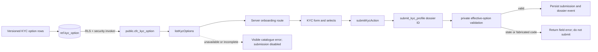

```mermaid
sequenceDiagram
  actor Borrower
  participant Route as Onboarding route
  participant Ref as Supabase reference view
  participant Form as KYC form
  participant RPC as Submission RPC

  Route->>Ref: Load effective options by category
  Ref-->>Route: code, label and order
  Route->>Form: Pass typed option groups
  Borrower->>Form: Select current catalogue values
  Form->>RPC: Submit explicit dossier and stored KYC profile
  RPC->>Ref: Validate every selected code against current effective rows
  alt All selected codes are current
    RPC-->>Borrower: Submit KYC and append dossier event atomically
  else A code expired or is unknown
    RPC-->>Borrower: Reject with the affected field; keep KYC unsubmitted
  end
```

## 7. Experience guidance and accessibility

- Use concise inline field descriptions for persistent instructions and accessible tooltip help for icon-only actions or specialized terms. A tooltip is supplementary and must not hide required information from keyboard, touch, or assistive-technology users.
- A shared Radix/shadcn tooltip provider and component now wrap the root layout. The assignment panel explains same-region eligibility, audit reason, and KYC separation. Extend this pattern to KYC evidence, savings pending/posted states, exports, and specialized staff registers.
- Add page-level help links or side-panel guidance where users need a longer explanation (KYC evidence rules, assignment state, savings transaction states, exports). Keep sensitive values out of tooltip text and browser logs.
- Every primary workflow provides visible validation, a clear next action, confirmation for irreversible decisions, and a recoverable error. Decision forms require a rejection reason where policy requires it.
- Ensure dialogs, tables, notification menus, and tooltips work by keyboard and have accessible names/focus behavior. Respect reduced motion and narrow-screen layouts.

## 8. Environment and data rules

### Local

- `.env.local` is loaded by the setup script as a private server-side input. Never dump its contents or copy service secrets to `NEXT_PUBLIC_*` values.
- Development-user seeding accepts loopback Supabase URLs only. Use the local secret/service key, and fail with the missing variable name, not its value.
- `system:local` is nondestructive; reset is separate and clearly named. Seed data is idempotent and generated/maintained through one fixture source.

### Staging

- Requires distinct `SUPABASE_STAGING_PROJECT_REF`, production project ref, access token, and database password (or the project's supported secure equivalents).
- Refuse missing or equal staging/production refs before linking or any network write.
- Preview migrations, apply only to the explicit staging ref, then run staging user/data seeding through a target-guarded script. Staging fixtures carry a seed marker/manifest and use non-production identities.
- No staging Supabase project is currently available in the connected organization; command implementation must not fabricate or infer one.

### Production

- Requires an explicit production ref and deployment credentials. Link/target that project, show a dry-run migration preview, then let the Supabase CLI require the operator's normal confirmation before applying.
- Never run `db reset`, `--include-seed`, or demo-user/data seed against production. Production staff accounts are provisioned through a controlled invitation/account workflow and real staff records, not fixture constants.
- Historical migrations are immutable after deployment. For existing synthetic rows, inventory exact source migration identifiers, preview affected rows/counts, and remove them only in a reviewed forward-only cleanup migration with a narrow allowlist and audit evidence. Never use broad email/name/code-prefix deletion.
- Environment selection controls both Supabase URL and public key for the Next app. Production build/deploy is separate from migration setup unless the actual hosting provider and credentials are explicitly added to the repo workflow.

## 9. Target workflow and role rules

1. **Staff provisioning:** real CFC staff identities receive a staff profile, role, and agency through a secured provisioning process. A self-service invitation/activation and availability screen remains future work. Identity email is not an assignment selector. Seed accounts exist only in local/staging.
2. **Dossier creation:** the persisted dossier agency identifies its region; the assignment RPC reads that configured agency relationship and fails closed when the region is absent.
3. **Assignment:** DB chooses the next same-region active GESTIONNAIRE in a locked round robin; dossier owner, assignment history, and durable in-app notification commit atomically. Admin can reassign with reason; no cross-region fallback.
4. **KYC review:** only the citizen and current assigned manager can load profile/evidence; only the assigned manager with the needed capability can decide. Admin reassigns without reading KYC payloads. Decisions append audit events.
5. **Documents:** one access decision applies to metadata and private storage. Expired/rejected/validated states remain explicit in history; replacing evidence preserves the old audit/version chain.
6. **Savings:** account opens for an eligible dossier; pending transactions are validated; posted ledger is append-only; balance changes in the same database transaction; statements query persisted ledger data.
7. **Notifications:** in-app notification persists for assignment, reassignment, decision, and other configured workflow transitions. Read state belongs to the recipient. Email is supplementary and retryable.
8. **Reporting:** dashboards derive metrics from database queries/views with explicit date/region/status filters, excluding deleted or synthetic data by default.

## 10. Implementation status and sequence

### Slice A — Reproducible operations — implemented; cloud use remains unverified

- `scripts/system.mjs` resolves local/staging/production configuration, checks dependencies, plans environment-specific commands, and keeps secrets out of printed output.
- Local, staging, and production commands are separate. Local applies migrations and fixtures only to loopback; staging links/migrates/seeds only a distinct staging ref; production links/migrates with confirmation and has no fixture-seed path.
- The local seeder reads `.env.local` itself and refuses non-loopback targets. Password-change template config and setup checks are corrected.
- Local migration replay has been exercised through `20261118190000`. Hosted staging/production runs have intentionally not been performed; a staging project must be provisioned before that path is usable.

### Slice B — Ownership and KYC boundary — implemented; security verification remains

- Regional manager eligibility/roster is queried from persisted staff assignments. The database serializes round robin by region and appends assignment history.
- Initial assignment, owner update, audit event, and durable in-app notification are transactional. An administrator can reassign to a same-region eligible manager with a required reason.
- KYC content is available only to the citizen or current assigned GESTIONNAIRE. Admin and non-owner staff screens use a safe dossier projection. KYC storage authorization follows the same ownership boundary.
- Role and agency authorization ignores deleted, future, and expired assignments. Application profile lookups also select only assignments active at read time.
- Next acceptance work: direct PostgREST/RLS denial tests for unassigned staff, former assignees, administrators, and cross-region users; review short-lived storage URLs and test reassignment revocation.

### Slice C — Persisted workspaces and analytics — major route conversion implemented; missing workflows remain

- Client list/detail, DUC document view, Kanban, assignment queue, safe staff dashboards, and analytics read actual records. No operational view falls back to seeded identities or fabricated chart series.
- Existing committee, notary, disbursement, reconciliation, mobile-money, and risk records use scoped database-backed registers. Routes with no backing table explicitly report that persistence is unavailable.
- The two dossier Kanban views use the Supabase process-phase catalogue for phase names and order; duplicate UI arrays have been removed.
- Analytics reads one security-invoker aggregate RPC and does not fetch customer profiles for charts. Individual savings and simulation analytics routes do not expose financial/customer data without a persisted, authorized record.
- Remaining product work: define and migrate missing promoter/expert/notary-directory/recovery/subsidy workflows, add their authorized create/update/decision actions, and finish a route-level responsive/error/empty-state review.

### Slice D — Carnet d'Épargne — retry-safe postings and full reversals implemented locally; reconciliation remains

- Passbook pages read persisted accounts and ledger entries. New operations are pending; validation/rejection and balance changes use role/scoped server actions and atomic SQL functions.
- Submission carries a stable client-generated UUID and a database-computed request fingerprint. A unique per-account idempotency index returns the original row on exact retry and rejects changed-payload reuse.
- A dedicated `savings:reverse` capability is granted to GESTIONNAIRE and ADMIN. The scoped RPC locks the account and source row, applies maker-checker and one-reversal constraints, appends the inverse transaction with the reason and linkage, updates the balance, and records the audit event atomically.
- Local pgTAP coverage verifies idempotent retry, mismatch rejection, independent approval, maker-checker, reversal retry/linkage, balance change, source immutability, duplicate reversal, capability denial, and rejection of expired/future staff assignments. UI/action tests verify request-key lifetime and RPC authorization.
- The interface does not treat React-only additions as posted transactions. Existing statements derive from persisted rows.
- Remaining product and verification work: concurrent validation/reversal race coverage, provider-reference policy and reconciliation, insufficient-funds edge coverage for both directions, statement/export/analytics reconciliation, and Finance sign-off on limits and full reversal policy. Partial adjustments are intentionally unsupported.

### Slice E — Data catalogue and colleague experience — in progress

- Workflow phase labels and process steps are sourced from Supabase and included in seed/migrations; email preview uses staff-entered sample values only.
- Existing CFC design tokens and installed Radix/shadcn components are preserved. Assignment, KYC, savings, empty, and access states have explicit UI affordances.
- Remaining work: inventory every route and runtime data import; provision real staff accounts through an administrative lifecycle; document schema ownership and missing persistence; run full tests, final build, local smoke, narrow-screen review, and Supabase security/performance checks.

### Persisted page and workflow inventory

| Area | Runtime source | Current behavior | Work still required |
|---|---|---|---|
| Borrower onboarding and tracking | `dossiers`, `dossier_events`, `dossier_documents`, reference views | Own dossier only; phase and process steps come from Supabase catalogue | Complete end-to-end borrower journey review, including no-config and failed-catalog states |
| Staff client queue and DUC detail | Safe dossier projection plus assigned-manager-only profile query | Borrower register switches between database-backed cards and table; DUC cabinet switches between database-backed grid and list; assigned GESTIONNAIRE opens the protected profile/KYC workspace | Verify former-assignee revocation and every document storage path |
| Admin assignment | Regional staff roster RPC and assignment RPC | Same-region active GESTIONNAIRE selection, mandatory reason, persisted history and notification | Add staff invitation/activation; exercise empty-region, reassignment revocation, and duplicate-submit cases; availability/caseload policy is not yet modeled |
| Kanban and actor dossier queues | `dossiers` and safe event fields under caller RLS | No fabricated records; role queue supports grid/list over the same scoped, searchable result set; detail remains within role scope | Add persistent board actions only where their domain transitions are defined |
| Savings passbook | Savings accounts and transaction ledger | Persisted rows; pending, approve, reject, retry-safe submission, and reasoned linked reversals | Concurrent race coverage, provider-reference reconciliation, statement/export/analytics reconciliation, and finance sign-off |
| Operations analytics | `get_cfc_analytics_rollup()` under invoker RLS | Aggregate metrics only; no customer identity/profile fetch in analytics | Verify numbers against report owners and expose supported reporting periods/filters |
| Agency, mobile money, committees, notary, disbursement, reconciliation, risk | Existing operational tables and scoped registers | Existing persisted rows only; supported registers switch between grid and list over the same searchable records | Add create/edit/decision flows only after domain owners approve state transitions and permissions |
| Promoter/expert/notary directories, recovery, subsidies | No authoritative persistent table/workflow found | Explicit “not persisted yet” state, without a fake directory or register | Define schema, data owner, lifecycle, permissions, audit, and migration before implementation |
| Saver/simulation analytics details | No authorized persisted analytics record is available | Individual detail paths fail closed; simulation history is described as non-persistent | Add an opt-in persistence model and retention/consent policy before history pages |

### Data ownership and seed contract

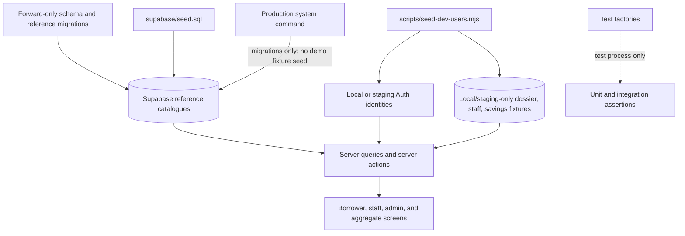

`supabase/seed.sql` owns repeatable reference content needed by a clean database. Auth-dependent synthetic accounts and operational examples stay in the target-guarded local/staging seeder. Production account provisioning is an explicit real-identity workflow. A route must not import a seed factory or test fixture. Labels and state-machine code may live in TypeScript; mutable/reference facts that administrators need to govern must be read from the selected Supabase project.

### Shared view modes

Cards and tables are two renderers over the same authorized, filtered read model. A view switch changes presentation only; it must not add a query, widen dossier scope, clear search/category filters, or change the action's server authorization. The current reusable mode control is applied to the staff borrower register, operational dossier queues, DUC document cabinet, and supported operational registers.

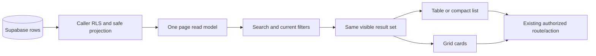

The implementation is covered by UI tests that search first, change to grid, and verify that the visible records and destination data remain the same. A future persisted view preference may be added without persisting or duplicating business data.

### Specialist workflow boundary

Non-manager roles have safe queue/detail views and document capabilities, but the current data model does not yet safely identify an assigned notary or BET account: `dossiers.notary_assigned` and `dossiers.bet_assigned` are free-text fields. Document requirements are versioned by service and a requirement stage (`NOTARY`, `MORTGAGE`, etc.), while `ref.process_phase` uses its own codes (`notary_mortgage`, `risk_bet`, etc.) and has no catalogued crosswalk. Do not expose generic upload or decision controls to those queues until a database-owned phase-to-requirement mapping and normalized specialist assignment model can drive both server checks and UI affordances.

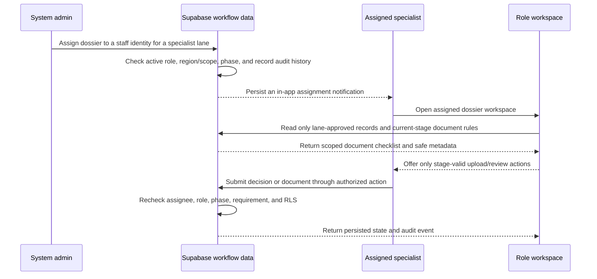

### Assignment notification interaction

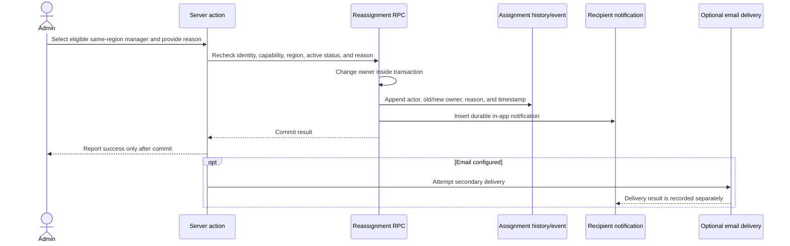

Notification payloads contain a safe dossier reference and action link, never KYC fields or uploaded evidence. Realtime is a delivery optimization; the notifications table remains the durable inbox. Email failure cannot undo an ownership change or remove the in-app notification.

## 11. Product journeys and lifecycle ownership

The portal is a set of connected work queues around a single Dossier Unique Client (DUC), not separate demo screens. The following activity model marks the business hand-offs and the records that must exist before the next role sees work:

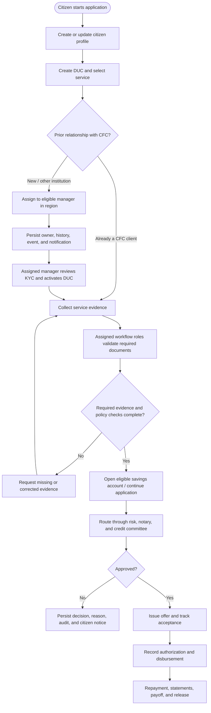

Each arrow is an explicit command/event with an authorized actor and persisted timestamp. A screen may display the state, but cannot invent or skip a transition. In particular, the savings flow must not be presented as a completed ledger until account opening, transaction validation, and balance updates are persisted.

## 12. Authorization and privacy model

Authorization is capability plus row scope plus workflow state. The current capability catalogue remains the source of permission names; this table documents the intended data boundary and must be validated against every RLS policy and server action before release.

| Resource/action | Citizen | Assigned manager | Other staff | System admin |
| --- | --- | --- | --- | --- |
| Read own identity/profile | Own record | Only within an assigned DUC when needed for review | Denied | Denied for KYC fields |
| Read dossier summary | Own DUC | Current assigned portfolio | Only explicit work-queue summary allowed by role | Assignment/queue metadata only |
| Read KYC evidence | Own submitted evidence | Current assigned DUC and authorized KYC workflow | Denied | Denied |
| Decide KYC | No | Current assigned DUC with verify capability | Denied | Denied |
| Change current owner | No | No | No | Reassign through audited command with reason |
| Read savings passbook | Own account | Scoped dossier and savings capability | Denied unless role/capability explicitly grants | Operational metadata only unless separately authorized |
| Post or validate a transaction | Submit request only where product policy allows | Only with explicit savings capability and scope | Denied | No implicit override |
| Read assignment history | Own state as configured | Own portfolio | No KYC-bearing payload | Yes, assignment metadata only |

**Admin separation of duty:** an admin may select an eligible manager, inspect region/role/assignability/load, and see assignment history. Assignment admin pages and RPC result types must omit KYC profile fields, document names, storage paths, and evidence. The restriction is enforced in RLS/storage and server query projections; hiding a component is not sufficient.

**KYC decision boundary:** every read and decision checks the current `owner_user_id` at request time. A prior assignee loses access as soon as reassignment commits. Document storage policies validate the dossier through the document row rather than trusting a caller-supplied path. Signed URLs are created only after the same authorization check and use the shortest duration compatible with the workflow.

## 13. Environment, release, and rollback topology

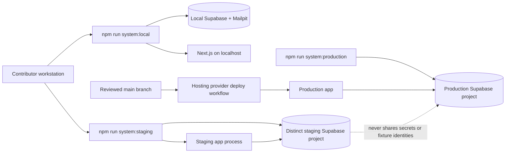

| Concern | Local | Staging | Production |
| --- | --- | --- | --- |
| Application URL/key | Loopback URL and local public key | `SUPABASE_STAGING_URL` and staging anon/publishable key | `SUPABASE_PRODUCTION_URL` and production anon/publishable key |
| Database targeting | CLI local default | Explicit `--remote=<staging ref>` | Explicit `--remote=<production ref>` |
| Migrations | Automatic pending apply on startup; destructive reset is separate | Preview, then explicit-target push | Preview, normal CLI confirmation, explicit-target push |
| Fixture users | Allowed after loopback check | Allowed after exact-ref and stage-only key checks | Prohibited by resolver and command plan |
| App hosting | Local process | Staging host/process configured separately | Provider-managed deployment; not executed by database bootstrap |
| Secret separation | Local secret key stays server-side | Staging seed key is not passed to app or CLI | Production DB credentials/token are not passed to app; no service key is needed |

**Release order:** review migrations and RLS; apply them to staging; run the seeded workflows and authorization matrix; deploy the app to staging; verify operational and error signals; schedule production migration; apply production migration with operator confirmation; deploy the application using the provider workflow; verify smoke paths and rollback readiness. A migration must be backward compatible with the currently deployed app for the interval between database and app rollout.

**Rollback policy:** do not rewrite or delete a deployed migration. Prefer forward repair migrations. For additive schema changes, rollback the app first only when the previous version remains schema-compatible; otherwise ship a forward fix. Back up/restore procedures and point-in-time recovery are platform operations and must be confirmed for each environment before the first production schema change.

## 14. Data integrity, audit, and operational invariants

| Invariant | Enforcement location | Evidence to retain |
| --- | --- | --- |
| A dossier has at most one current manager | Unique/transactional assignment operation | Assignment event with previous/new owner, actor, reason, timestamp |
| Auto-assigned manager is eligible for the dossier's region | Assignment function checks live staff/agency/role eligibility | Eligibility decision and assignment history |
| KYC evidence is visible only to citizen/current assignee | RLS + Storage policy + server query | Access denied tests and KYC decision audit |
| An assignment notice follows committed ownership | Same DB transaction or committed outbox event | Notification row keyed to assignment event |
| A notification is recipient-owned and deduplicated | RLS and unique `dedupe_key` | Notification delivery/read timestamps |
| Savings balance equals posted ledger projection | Atomic account lock + immutable ledger write | Transaction ID, validator, reference, balance-after |
| Production has no generated demo facts | Production command resolver and deployment config | Production seed guard test and seed-run audit |
| An empty query stays empty | Query layer never substitutes fixture values | Empty-state behavior and query error telemetry |
| Failed write leaves no partial business state | One transaction/RPC for multi-row invariants | Transaction rollback and retry/idempotency tests |

Sensitive events must not copy identity numbers, document URLs, or full KYC JSON into notification payloads, assignment logs, analytics, or client-side telemetry. Logs should carry the dossier's opaque internal ID only when access controls permit it and should use a request/correlation ID for support.

## 15. Failure behavior and recovery

| Failure | Required user-visible behavior | Recovery |
| --- | --- | --- |
| Local Docker is unavailable | Name the Docker prerequisite; do not pretend the system is ready | Start Docker, rerun `system:local` |
| Local service key absent | Show the exact variable name and `.env.local` location, never a key value | Copy local key from local `supabase status -o env`; rerun |
| Cloud ref missing/mismatched | Stop before linking or mutation and identify the variable/target error | Correct isolated environment config |
| Migration dry-run fails | Stop before push; preserve CLI diagnostic output | Fix migration ordering/compatibility, rerun preview |
| Migration push is declined or interrupted | Stop before seeding/app startup; leave no false completion message | Review CLI output and retry after deciding |
| No eligible regional manager | Keep the dossier unassigned and visible in a restricted admin queue | Provision/activate an eligible real staff account or reassign |
| Assignment notification transport fails | Keep committed assignment and durable in-app notification; surface delivery status | Retry email asynchronously; do not undo ownership |
| KYC/savings query fails | Show an error with retry/support correlation; never replace with fixture data | Retry and inspect server/database logs |
| Next reports a deleted source file during production build | Clear the stale production webpack resolver cache before compilation; preserve development caches | Run `npm run build`, which invokes the scoped prebuild cleanup |
| Ledger validator races another validator | One transaction wins; the other receives a stable conflict response | Reload account and transaction queue |

## 16. Acceptance map and unresolved product decisions

| Request | Acceptance evidence | Status |
| --- | --- | --- |
| Local command loads `.env.local`, starts local services, migrates, seeds, and starts Next | System command tests; local migration replay; clean-clone run | Implemented; local stack/migrations work; full clean-clone build/smoke still required |
| Separate staging and production commands | Ref/URL guards, target-specific plans, secret boundary tests | Implemented; no staging ref configured and no hosted writes performed |
| Production migration command has no fixture seed path | Production command plan contains no seed/reset/include-seed step | Implemented and covered by system tests |
| Assign by same-region round robin; allow audited admin reassignment | Assignment RPC, eligibility roster, history, action result, database authorization tests | Implemented in branch; concurrency and direct-RLS denial coverage remains |
| Only citizen/current assigned GESTIONNAIRE may read KYC | Scoped query/action, RLS/storage policy tests for owner, former owner, other region, and admin | Implementation present; direct access matrix still requires full verification |
| Notify the new assignee after assignment commits | Notification row inserted in the assignment transaction; recipient inbox read | Implemented in database path; delivery/realtime behavior requires end-to-end check |
| Use real staff identities outside seeded environments | Explicit admin invitation, activation, region, role, and availability lifecycle | Roster and local/staging fixtures exist; production invitation/availability admin flow remains |
| Remove operational mock/dummy records | Route/import inventory, database-backed query coverage, no fallback fixtures | Major screen families converted; unsupported registers show empty/persistence notice; full scan remains |
| Carnet d'Épargne is persisted and auditable | Ledger actions/RPC, scoped RLS, idempotency/reversal pgTAP, concurrent decisions, and reconciliation checks | Persisted read/approve/reject, retry-safe submission, and append-only reversal implemented; race coverage and reconciliation remain |
| Helpful accessible detail/field guidance | Shared Tooltip component, keyboard/focus checks, responsive route review | Tooltip foundation and assignment help implemented; page-by-page review remains |
| Strong system specification and process diagrams | Architecture/component/sequence/data/authorization diagrams plus route/persistence inventory | Documented here; keep updated as remaining workflows are specified |

The current region source is the dossier's configured agency and its persisted region. The KYC rule is fixed by the request: only the assigned GESTIONNAIRE validates KYC or reads full profile data; an administrator may change ownership but sees no KYC payload. Remaining business approvals concern staff invitation/availability, savings financial limits/reference policy and possible partial adjustments, and any legacy hosted-fixture cleanup. Until those are approved, retain the current guarded behavior and do not change hosted data.

## 17. Glossary

| Term | Meaning |
| --- | --- |
| **CFC** | Crédit Foncier du Cameroun |
| **DUC** | Dossier Unique Client, the primary citizen/application work item |
| **KYC** | Identity and customer due diligence information and evidence |
| **Current assignee** | The one staff account in `dossiers.owner_user_id` that currently owns a dossier review |
| **Region/agency** | The CFC territory attached to the persisted agency on a dossier and on a staff role assignment |
| **Fixture** | Synthetic identity/business data used only in tests, local development, or isolated staging |
| **Ledger entry** | Immutable savings transaction fact; corrections append an inverse/reversal rather than editing the posted fact |
| **Outbox** | Persisted event committed with a business change and delivered to asynchronous integrations after commit |

## 18. Completion and acceptance criteria

### Operations

- A clean clone can follow the documented prerequisites and start local Supabase + the portal with one command; no manual shell export is required for values already in `.env.local`.
- Local startup does not reset existing local data. A separate reset command clearly indicates destruction.
- Staging command refuses missing/equal target refs; staging creates seed accounts/fixtures only after its target passes validation.
- Production command refuses a missing target, previews migrations, requires normal CLI confirmation, never seeds demo users/data, and never resets.
- All auth template paths resolve in `supabase status`/config validation; the password-changed notice has no duplicated `supabase/supabase` path.

### Data and authorization

- No operational page imports a demo identity, demo dossier, static board, or local-only savings transaction.
- Every visible client/task/KPI/transaction is backed by the selected Supabase environment and authorized query scope.
- Citizen own-profile access succeeds; current assigned regional manager can review; unassigned/other-region manager and system admin cannot read KYC profile/evidence through server actions, PostgREST, RPCs, or Storage.
- Reassignment is region/eligibility checked, reasoned, durable, and notified after commit; transaction concurrency cannot assign two consecutive cases to the same staff member when another eligible member is next.
- Savings entries, validation/rejection, balance, audit, and exports remain consistent after reload and retries; no direct UI-only mutation is represented as completed.
- Demo records can be identified by fixture manifest in local/staging and are excluded from production. Any cleanup of legacy live records uses exact reviewed identifiers and a preflight report.

### Interface and quality

- Every data-bearing page distinguishes loading, no data, no permission, and request failure.
- Important state/action terminology is explained with accessible inline help or tooltips; long instructions have a visible help destination.
- Every action reports success only after durable persistence. Rejected/failed operations retain the user input where safe and show a recovery path.
- Build, typecheck, lint, and tests pass on the final branch state; modified database areas pass targeted RLS/SQL tests and Supabase advisors.

## 19. Risks and guardrails

- **No staging project is configured.** Keep staging command fail-closed; do not guess a ref or seed production as a substitute.
- **Legacy cloud fixtures exist.** Do not mutate cloud data during implementation. First produce an exact dry-run manifest, then include an auditable forward-only cleanup migration only for source-verified fixtures.
- **Sensitive KYC data.** A frontend visibility rule is insufficient; RLS and storage checks must enforce ownership even through direct API requests.
- **Workload/leave availability is absent.** Round robin currently selects active staff role assignments in the dossier region; add capacity/leave policy and controls before claiming those semantics.
- **CLI version/path differences.** Pin the CLI version, verify commands with the pinned `--help`, and test both PowerShell/Windows and POSIX process invocation where possible.
- **Historical seed migrations.** Never rewrite migrations already applied to cloud. Separate reference catalogue seed from synthetic users/workflow fixtures going forward.
- **Financial ledger integrity.** Do not use client-calculated balances or destructive corrections; keep account-row locking, idempotency, audit, and reversing entries in the database transaction.

## 20. Research references

- Supabase local workflow and target selection: [CLI workflows](https://supabase.com/docs/guides/local-development/cli-workflows), [local and hosted projects](https://supabase.com/docs/guides/local-development/local-and-hosted-projects), [database migrations](https://supabase.com/docs/guides/local-development/database-migrations).
- Supabase seed separation and warning against production seeds: [Seeding your database](https://supabase.com/docs/guides/local-development/seeding-your-database).
- Supabase authorization boundary: [Row Level Security](https://supabase.com/docs/guides/database/postgres/row-level-security).
- Database functions should preserve caller scope with invoker security where practical: [Supabase Database Functions](https://supabase.com/docs/guides/database/functions).
- Current CLI command targeting and hosted-operation behavior should be rechecked against the [Supabase CLI changelog](https://supabase.com/changelog.md).
- Supabase Auth template paths: [Customizing email templates](https://supabase.com/docs/guides/local-development/customizing-email-templates).
- Supabase API-key transition guidance, including legacy `service_role` and new server-only secret keys: [Migrating to publishable and secret API keys](https://supabase.com/docs/guides/getting-started/migrating-to-new-api-keys).
- Shared accessible help layer: [shadcn/ui Tooltip](https://ui.shadcn.com/docs/components/radix/tooltip); form validation/accessibility conventions: [shadcn/ui React Hook Form](https://ui.shadcn.com/docs/forms/react-hook-form).
