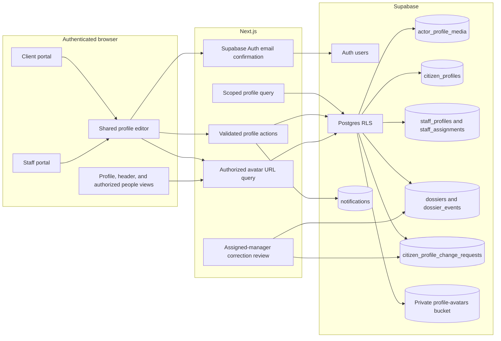
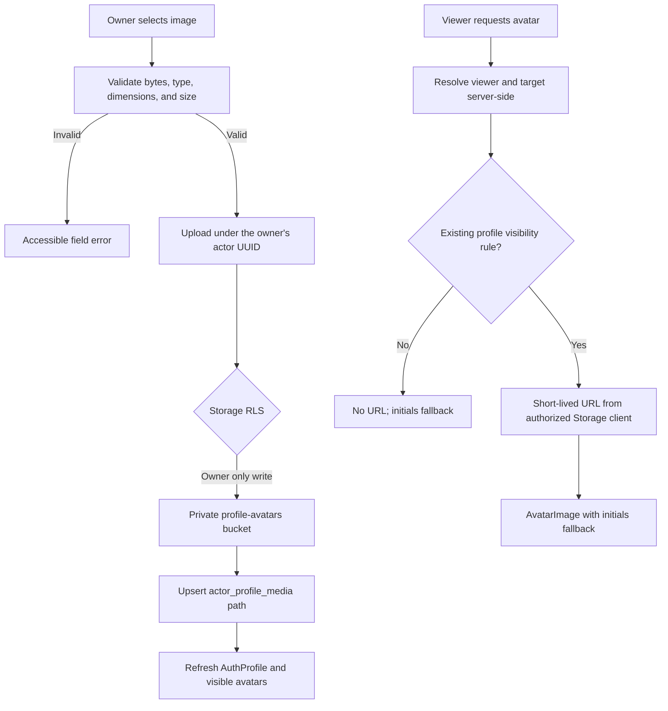

# Self-Service Profiles and Private Avatars

**Date:** 2026-11-18  
**Status:** Implemented on `develop`; local database and server-action verification passed. Hosted rollout remains pending.  
**Scope:** Authenticated client and staff profile editing, profile photos, safe visibility in existing people views, and a reviewed legal-name correction path after KYC submission.

## 1. Product outcome

Every authenticated person can keep their own account profile current and add a profile photo. Client and staff screens show the same persisted identity and photo wherever the current authorization rules already allow the viewer to see that person. The profile feature must not let a user change their staff role, agency, dossier assignment, KYC status, or verified identity facts outside the established review process.

The signed-in user's Supabase Auth record is authoritative for the email address. `citizen_profiles` and dossiers hold operational email copies and must follow a verified Auth email change. Staff authorization continues to come from `staff_assignments`; profile editing never writes it.

## 2. Research and repository findings

Supabase Storage applies `storage.objects` RLS to private bucket reads and writes. Private assets can be delivered through an authenticated request or a time-limited signed URL. Public buckets bypass read access control for anyone who has the URL, which is inappropriate for client identity photos. Supabase Auth email changes have confirmation flows; the application must report a pending change until confirmation completes. Sources: [Storage access control](https://supabase.com/docs/guides/storage/security/access-control), [Serving private assets](https://supabase.com/docs/guides/storage/serving/downloads), and [Auth email templates and confirmation behavior](https://supabase.com/docs/guides/auth/auth-email-templates).

Current implementation facts:

- Staff and client profile routes render the shared read-only `ProfilePanel`.
- `getServerProfile()` and the browser auth context load identity independently. Both must expose the same avatar path/URL and refresh after an edit.
- `citizen_profiles.full_name` is projected into the latest dossier's `name`; `saveKycDraftAction` currently updates both, including after a KYC submission. A KYC submission timestamp is stored in `kyc_profiles.submitted_at`.
- `staff_profiles` stores staff name and phone, but staff writes are currently admin-only. The self-service capability should not broaden writes to role, pole, job title, department, or agency.
- The UI has a shared Avatar primitive and several client cards use initials-only fallbacks. Existing KYC/document Storage is private and uses signed-download patterns.
- No profile-photo storage bucket, avatar path, or profile-edit action currently exists.

## 3. Design decision

Use a shared profile editor over the existing shared profile panel, with a separate, minimal profile-media record and a private Storage bucket. Use narrow server actions for profile mutations, Supabase Auth's verified email change flow for email, and a durable, assigned-manager-reviewed correction request for a client's legal name after KYC is submitted.

This avoids duplicating authorization fields, avoids a public photo URL for client identity, and keeps operational records aligned when a name, phone, or email changes.

## 4. Editable fields and invariants

| Field | Client | Staff | Source of truth | Rule |
|---|---|---|---|---|
| Display/legal name | Editable before first KYC submission; correction request afterward | Editable by self | `citizen_profiles.full_name` / `staff_profiles.full_name` | Validate non-empty, bounded length; synchronize client dossier name. After submission, preserve verified name until assigned GESTIONNAIRE accepts a correction request. |
| Contact phone | Editable by self | Editable by self | `citizen_profiles.phone` / `staff_profiles.phone` | Normalize to E.164; synchronize client dossier contact phone. Do not change the user's Auth phone factor implicitly. |
| Email | Request change by self | Request change by self | Supabase Auth `user.email` | Use Supabase's confirmation flow. Until confirmed, keep showing the current email and show the pending target. On confirmation, synchronize citizen profile and dossier copies. |
| Profile photo | Upload, replace, remove by self | Upload, replace, remove by self | `actor_profile_media.avatar_path` + private Storage object | Store the object path only, never a signed URL. Validate content type, size, and image dimensions. |
| Role, agency, pole, scope, job title, assignment | Read-only/not applicable | Read-only | `staff_assignments`, staff/agency records | No self-service write path. |
| KYC, risk, affiliation verification, identity document values | Not editable from the generic profile | Not applicable | Existing KYC state and review flows | Profile actions cannot accept these fields. |

Client phone remains self-service after submission because it is a contact channel, not a KYC decision. A phone update must not modify a verified phone factor or any KYC decision field. The user's email change is pending until Auth confirms it; database copies only move after the confirmed Auth record changes.

### Legal-name correction lifecycle

1. Before first KYC submission, a client can edit their legal name directly. The operation updates their profile and latest non-deleted dossier in one transaction.
2. After the first submission, the profile shows the verified name as read-only and offers **Request a name correction**.
3. The client enters the requested name and a reason. This creates a pending request and an in-app notification for the currently assigned GESTIONNAIRE. It does not alter the legal name or dossier.
4. Only the assigned GESTIONNAIRE can approve or reject the request. Approval atomically updates the client profile and dossier copy, closes the request, and records a dossier event. Rejection closes the request with a reason; the current legal name remains unchanged.
5. Only one pending name correction per client is allowed. A manager reassignment must not silently transfer a decision; the current assigned manager is revalidated when the decision action runs.

## 5. Architecture



The browser receives only the signed-in user's session. It never receives a service-role key. Profile actions derive the actor ID from `auth.getUser()` and do not accept an actor ID from the client as an authority. Postgres remains the final boundary for profile ownership, staff authorization, assigned-manager review, and Storage access.

## 6. Profile edit flow

```mermaid
sequenceDiagram
  actor Person
  participant UI as Profile editor
  participant Action as Server action
  participant Auth as Supabase Auth
  participant DB as Postgres/RLS
  participant Notif as Notifications

  Person->>UI: Edit name, phone, or photo
  UI->>Action: Submit validated fields
  Action->>Auth: Resolve current authenticated user
  Action->>DB: Apply narrow self-owned update
  DB->>DB: Check KYC submission and field policy
  DB->>DB: Keep client profile and dossier copies aligned
  DB-->>Action: Commit or return field error
  Action-->>UI: Result and refreshed profile

  Person->>UI: Request email change
  UI->>Auth: updateUser(new email)
  Auth-->>Person: Send confirmation message
  Note over Auth,DB: Keep the current email until Auth confirms the change.
  Auth->>DB: Confirmed email update
  DB->>DB: Synchronize citizen profile and dossier email copies

  Person->>UI: Request legal-name correction after submission
  UI->>Action: Proposed name and reason
  Action->>DB: Create pending correction request
  DB->>Notif: Notify currently assigned GESTIONNAIRE
  DB-->>UI: Pending review; verified name unchanged
```

### Email synchronization

The Auth-confirmation path must synchronize `citizen_profiles.email` and all non-deleted dossiers owned by the citizen after the confirmed email update. It must not use an admin update to bypass the confirmation flow. A database trigger or equally reliable server-side Auth event is required so a user who confirms from another device still gets synchronized. The implementation must be idempotent and tested against local Supabase Auth.

Staff emails are read from Auth and are not duplicated in `staff_profiles` today.

## 7. Photo access and upload flow



### Photo policy

- Keep the bucket private. A signed URL is a short-lived bearer link; never store it in Postgres, logs, or long-lived browser state.
- Owner can insert, replace, and delete only objects below their own actor UUID path. The storage key is generated by the server and versioned so replacement does not reuse a stale CDN path.
- Reads are permitted to the owner; to active staff viewers for staff photos; and to the currently assigned GESTIONNAIRE for a citizen photo when the same assigned-dossier predicate used for KYC profile reads succeeds. Other clients and unassigned staff cannot read citizen photos.
- Avatar views use the existing shadcn/Radix Avatar primitive. If no photo exists or URL access fails, retain a deterministic initials fallback; no fake/demo photo is substituted.
- Accept raster formats only (JPEG, PNG, WebP); reject SVG and unknown content. Enforce a configured byte limit and image dimensions on both client and server. Crop/preview is optional, but keyboard operation and accessible labels are required.
- Removing a photo removes the metadata pointer and the owner's object. If object deletion fails after metadata removal, surface a recoverable cleanup error and never reveal the old path in the UI.

## 8. Data model and authorization

### `actor_profile_media`

One row per actor, created only when a photo is set.

| Column | Purpose |
|---|---|
| `actor_id` | Primary key and FK to `public.actors(id)` |
| `avatar_path` | Private bucket object key; nullable only if retaining an explicit empty row is operationally useful |
| `updated_at` | Server-maintained change timestamp |
| `updated_by` | Audit actor; always derived from the authenticated user for self-service writes |

RLS rules:

- Owner may select/insert/update/delete their row.
- Staff may select staff media only where the staff directory/assignment view already permits the corresponding staff record. The initial implementation may use the current staff-profile read boundary and should not broaden it.
- A citizen media row is readable only by that citizen or the active assigned GESTIONNAIRE. Use the same active `dossiers.owner_user_id` predicate as `citizen_profiles_read`; do not grant all staff blanket citizen-photo access.
- No client-supplied actor ID, role, agency, signed URL, or object key can grant access.

### `citizen_profile_change_requests`

An auditable request table for post-submission client legal-name corrections. It stores the proposed name and reason, not identity documents. Columns include request ID, citizen ID, requested field (initially only `full_name`), proposed value, reason, pending/approved/rejected status, reviewer actor, reviewer note, created/reviewed timestamps, and standard audit fields. Enforce one pending request per citizen with a partial unique index. RLS permits the owner to create and read their own requests; only the currently assigned GESTIONNAIRE may read and decide; no direct authenticated updates to protected status fields. Narrow RPCs/actions perform create and review transitions.

### Staff profile self-service

Do not make the existing admin-only `staff_profiles_write` policy permissive for self. Introduce narrow self-update permission in an RPC or a column-restricted security-definer function for `full_name` and `phone`. The function checks `auth.uid()`, active staff actor type, and current staff record. Agency, role, scope, pole, job title, department, and assignment remain protected.

### Client profile self-service

Name and phone changes must update only explicitly allowed columns. For pre-submission name changes, write the same value to the latest non-deleted dossier in the same database transaction. Phone updates synchronize the current client profile and latest non-deleted dossier. Never allow profile update inputs to write affiliation verification, CNI, birth date, KYC state, risk, or audit owner fields.

The existing broad row-level `citizen_profiles_update` policy and KYC draft action are not sufficient column boundaries. Add a narrow self-profile RPC and a database guard for the submitted-name rule; update the KYC draft action to use the same editability policy. At the database boundary, reject changes to `full_name` once `kyc_state` has left the pre-submission states (`pre_boarding`, `identity_capture`) or `submitted_at` is set, except through the manager-review RPC. Do not trust `submitted_at` alone because the KYC row currently has a broad self-write policy. Keep the guard tied to the protected KYC state as well.

Limit authenticated table grants to the columns needed by existing KYC declarations and decisions; keep authorization fields and audit ownership server-controlled. Staff profile self-service must use a narrow function that updates only `full_name` and `phone`; the existing admin-only staff write policy must not be broadened into unrestricted self-write. Every security-definer function uses an empty/restricted `search_path`, derives the actor from `auth.uid()`, validates actor type and current assignment, and grants execute only to `authenticated` where needed.

## 9. UI and interaction requirements

- Preserve the existing CFC visual system and shared `ProfilePanel` route structure.
- Add an edit action to the identity card and an accessible edit dialog or dedicated form section with field-level errors, cancel, save, and pending/success feedback.
- Add avatar preview, upload, replace, remove, upload progress, file guidance, and a clear fallback. Do not show upload success until storage object and metadata are committed.
- For Auth email changes, show current email, pending email, and confirmation state; do not optimistically replace the current email.
- For submitted client KYC, render the legal name as verified/read-only and expose a correction request form with reason, pending state, reviewer result, and status history.
- Staff role, agency, scope, pole, and job title remain visibly read-only. Add explanatory tooltip/help text that directs the user to the authorized administrator for changes.
- Use the same avatar projection in user menu, staff sidebar, client list/kanban/workspace, and dossier detail only where the viewer's data access already permits the target record. Keep initials as the normal empty state.
- Account changes refresh `AuthContext` and server components so a profile edit immediately appears in both portal chrome and profile views.
- Every editable form supports keyboard-only use, labels and descriptions, visible focus, announced errors/status, and a usable narrow/mobile layout.

## 10. Failure handling and privacy

| Failure | User-visible result | Data behavior |
|---|---|---|
| Expired/missing session | Session-expired message and sign-in link | No writes |
| Invalid name/phone/image | Field-level message | No writes or stored object |
| Upload succeeds but metadata write fails | Retry/cleanup message | Remove orphan object or queue deterministic cleanup |
| Email change request succeeds | Confirmation-pending state | Current Auth and dossier email stay unchanged until confirmation |
| Email confirmation synchronization fails | Log a structured server error and retryable sync state | Do not substitute the unconfirmed value |
| No assigned manager for correction request | Explain that a reviewer is not available and provide support route | Do not create an unreviewable pending request |
| Manager is reassigned before decision | Reject stale decision attempt | Existing assignment remains authoritative |
| Viewer lacks avatar access | Initials fallback | Do not leak object path or signed URL |

Do not log raw image bytes, signed URLs, proposed name values, Auth confirmation tokens, or secrets. Audit records should include actor IDs and request status transitions, not unnecessary client identity values.

## 11. Tests and acceptance criteria

Implementation is accepted only when:

1. Both client and staff can update their own permitted name/phone fields; another user's profile cannot be modified by changing a request payload.
2. Client updates keep the citizen profile and latest active dossier copy consistent in one transaction.
3. A submitted client's name is immutable through both the profile editor and KYC draft action; a correction request leaves the verified name unchanged until the assigned manager approves it.
4. Only the currently assigned GESTIONNAIRE can decide a name correction; reassigned or unrelated staff cannot.
5. Staff can edit only their own name/phone. Attempts to change role, agency, assignment, or other administrative fields fail at the database boundary.
6. Email changes stay pending until Supabase Auth confirmation and then update client profile/dossier copies, including when confirmation occurs in a separate session.
7. Users can upload, replace, and remove their own valid photo; invalid types/sizes are rejected; object metadata cannot point at another user's path.
8. A client photo is readable by the owner and currently assigned GESTIONNAIRE only. An unassigned staff account and another client cannot read it or mint a signed URL.
9. Private photo URLs expire, are not persisted, and are not used as stable profile data. Missing photos display initials.
10. Profile photos appear on the shared profile, account menu, sidebar, and authorized client/staff surfaces without changing existing row visibility.
11. UI interactions are keyboard-accessible, preserve CFC styling, expose upload/save/email/request states, and behave on mobile widths.
12. Local migration, RLS/storage-policy, server-action, auth refresh, and UI component coverage passes. No hosted data or environment is changed as part of feature verification.

Recommended implementation coverage includes migration-level RLS cases for owner, assigned manager, unassigned manager, other client, and staff peer; unit tests for validation and KYC editability; local Supabase integration tests for Auth email sync and transactional profile updates; and component tests for photo fallback and pending states.

## 12. Rollout and operational notes

- Add migrations for profile media, correction requests, private bucket configuration, policies, triggers/functions, and indexes. Keep every schema change forward-only and repeatable through Supabase CLI.
- Existing people retain initials until they choose a photo. No demo photo or mock profile is seeded in production.
- Local and staging may seed staff/client accounts under the existing guarded seeding rules; avatar fixtures are optional and must be explicit, deterministic, and non-personal. Production seeding remains disabled.
- Generate signed URLs only after viewer authorization and keep their lifetime short. Since signed URLs are bearer links until expiration and cannot be individually revoked, use brief expirations and versioned object paths. See [Supabase signed URL behavior](https://supabase.com/docs/guides/storage/serving/downloads).
- Any email Auth hook/trigger must be tested with the repository's local Supabase version before deployment; verify hosted Auth settings and email templates separately during the environment deployment checklist.

## 13. Out of scope

- Letting a user change their role, agency, dossier owner, KYC status, or other staff permissions.
- Public client profile URLs, public photo buckets, or global client directories.
- Replacing existing KYC or staff provisioning workflows with profile self-service.
- Setting an Auth phone factor from the operational contact-phone field.
- Storing arbitrary gallery images or identity documents as avatars.
- Editing any user's profile from the profile screen; administrative identity management remains a separate governed workflow.

## 14. Implementation record

- A shared profile editor is mounted on both staff and client profile routes. It supports self-service display name/contact phone/photo, verified Auth email change requests, and a request/review history for post-submission client legal-name corrections.
- The private avatar bucket, actor media table, profile policies/RPCs, and correction workflow are defined in `20261118193000_profile_self_service.sql`; follow-up forward migrations add shared audit-column compatibility and request-scoped correction behavior. No public profile photo URL or browser service-role key is used.
- Profile updates derive the actor from the authenticated session. Staff role/scope remain read-only. Client legal-name corrections are tied to a selected dossier and its current assigned GESTIONNAIRE; open dossier copies synchronize without rewriting closed history.
- Local profile pgTAP passed 27 assertions, including owner/assigned-manager visibility and exact-dossier correction routing. Profile action tests passed. Full Vitest passed (448 passed, 17 environment-gated skips), `npm run test:system` passed (40), and typecheck, ESLint, and production build passed.
- Hosted Auth email templates and redirects still need an environment-specific check when staging is configured. No hosted database or Auth configuration was changed here.
