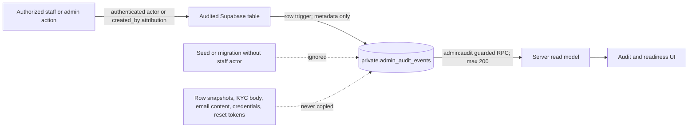
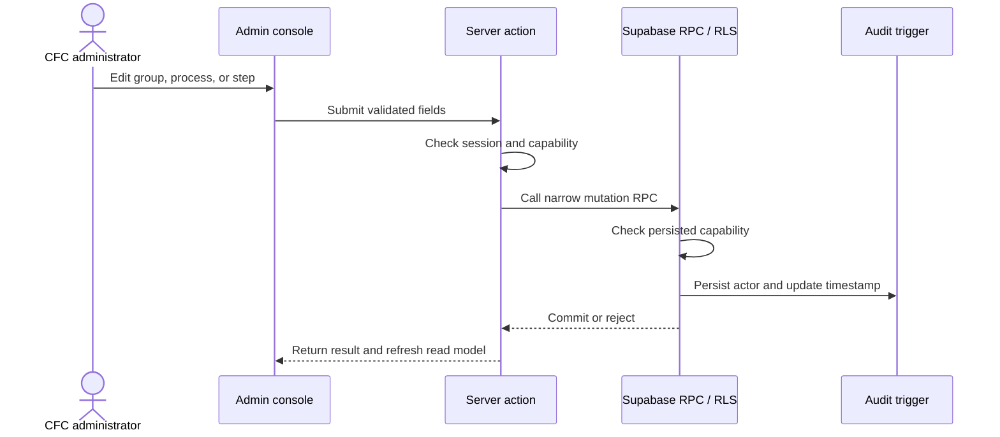
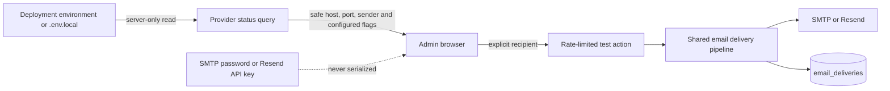
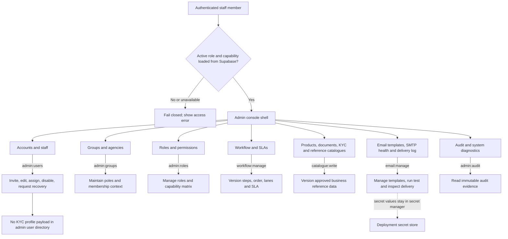
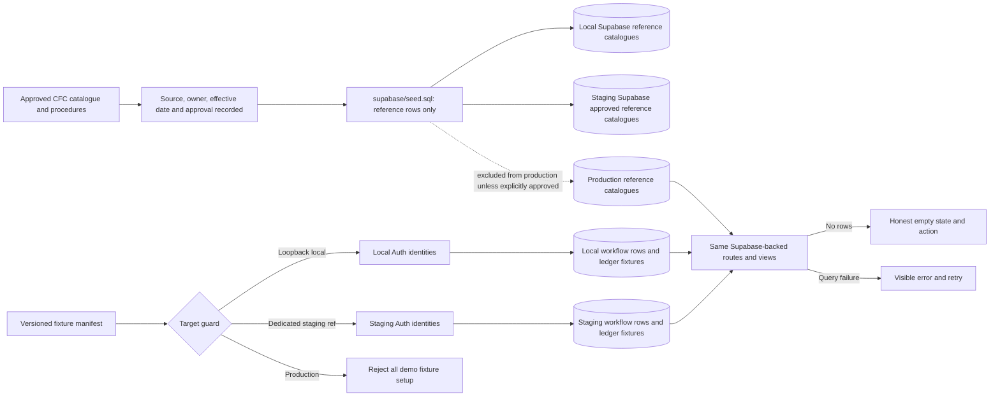
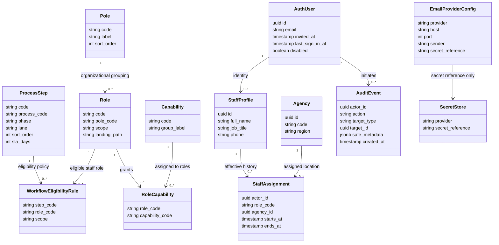

# Administration, Configuration, and Seeded Operations — Design Specification

**Date:** 2026-11-19  
**Status:** Approved direction; the core governance console and safe audit/readiness view are implemented. Phase-aware document decisions, complete stage fixtures, credit closure, and external-party directories remain open. Existing WIP is preserved.  
**Related:** [System completion design](2026-11-18-cfc-system-completion-design.md), [commercial-counter workflow](2026-11-19-commercial-counter-workflow.md), [Supabase source research](../../research/cfc-commercial-counter-source-research.md)

## Goal

Give authorized CFC system administrators one coherent console to manage staff accounts, organizational groups, role/capability assignments, workflow and reference configuration, email operations, and audit evidence. Provide repeatable local and staging data that exercises each supported workflow stage so staff can review real page behavior without putting fabricated records into application code or production. Preserve the existing CFC visual system, keep card/list views, and use the same persisted Supabase records in every view.

The administrator console is a control plane. It does not grant administrators unrestricted access to borrower identity evidence: the existing rule remains that only the currently assigned, authorized GESTIONNAIRE can read full KYC details or validate a client's KYC.

## Current state observed in the repository

- `src/config/rbac/sidebar-by-role.ts` exposes staff accounts, poles/agencies, workflow processes/steps, role permissions, email templates/delivery history, provider status, and audit/readiness under capability-filtered admin navigation.
- The governance UI exposes protected user, assignment, role, group, workflow, email, and audit operations. Password reinitialization uses a recovery link; administrators do not view or set reusable passwords.
- Audit history is append-only metadata for administrative/configuration changes. It stores the actor, actor role, operation, table, safe entity key, and timestamp; it intentionally stores no row snapshots, email body/recipient, password/reset token, credentials, or KYC payload.
- Email settings, delivery actions, and provider tests use email capabilities. SMTP/Resend values are read server-side; the admin page returns only non-secret connection metadata and booleans for credential presence.
- `ref.role_capability` is the effective staff grant source. Server profiles and the middleware load the active grants; action guards, capability-gated navigation, route access, and RLS use that set. TypeScript retains a role/capability catalogue for validation and older pure-policy callers, never as a fallback when an authenticated staff profile has an empty or unreadable grant set.
- The current local fixture seeder provisions 16 staff accounts, 98 borrower accounts, and 100 dossiers (20 in each of five modeled phases), with 2,656 catalog-driven private synthetic PDF files. It writes operational rows to Supabase rather than rendering mock records in components, but it does not yet demonstrate every workflow module or seed a versioned manifest.
- Card/list controls already exist for the borrower register and DUC documents. The operational register and dossier queue also have view toggles. New work should retain and verify these controls, then add views only to screens where an alternate view materially helps.
- The CFC seed includes approval-threshold rows and product values that conflict with the provided meeting notes or public CFC pages. These are unverified, not an executable policy. The source research documents the conflicts; do not replace them with guessed public thresholds.

## Implemented administration slices

- **Staff directory:** staff-only read model; invitation/recovery links; profile, assignment, activation, and reset actions; search and card/list views. It does not select citizen KYC fields.
- **Groups:** persisted poles/agencies; audited save operations; role/agency counts; search and card/list views. Membership remains in effective-dated staff assignments.
- **Workflow:** persisted process, phase, and step reads; process/step changes use guarded RPCs; step order changes are audited. Phase codes display read-only because they are stable references already used by dossier history.
- **Mail provider:** server-only SMTP/Resend status, recent delivery aggregates, and a rate-limited test send. Secrets stay in `.env.local` or deployment secret storage.
- **Role permissions:** capability grants for all 12 active typed staff roles are editable through `/portail-cfc/settings/roles`; the `ADMIN` bootstrap role is read-only. The capability catalogue now covers all active grants, direct table writes are revoked, the guarded RPC rejects unknown grants, and removals are soft-deleted with audit columns. New role-code creation remains unsupported by the typed application routes.
- **Least privilege:** full KYC read, verification, and decision grants remain limited to `GESTIONNAIRE` and are still narrowed by the assigned dossier. PMO no longer inherits account and role administration, Audit retains audit access without account administration, and the system administrator does not gain borrower KYC visibility.
- **Register correctness:** the SYSTAC register filters to the `systac` channel rather than returning every reconciliation run.
- **Audit and readiness:** `/portail-cfc/settings/audit` reads a capped, capability-guarded audit stream and shows live role, capability, orphan-grant, workflow, and email-provider readiness. Its card/list modes display the same database-backed events.

Administrative change evidence follows this path:



The audit row contract is `actor_id`, `actor_role`, `action`, `entity_type`, `entity_key`, and `occurred_at`. Service-role email-delivery writes retain the initiating staff actor from the delivery row's `created_by` field. The UI receives only this allow-listed contract.

The effective authorization path is now database-backed end to end:

```mermaid
sequenceDiagram
  actor Staff as Staff member
  participant Auth as Server profile / middleware
  participant Grants as ref.role_capability
  participant Menu as Capability-filtered menu and route gate
  participant Action as Server action
  participant RLS as Supabase RLS and guarded RPC
  Staff->>Auth: Request application route
  Auth->>Grants: Read active grants for assigned role
  Grants-->>Auth: Capability codes or empty set
  Auth->>Menu: Apply live grants; missing data fails closed
  Staff->>Action: Submit operation
  Action->>Grants: Recheck live grant set
  Action->>RLS: Execute authenticated query/RPC
  RLS->>Grants: Recheck persisted authorization
  RLS-->>Staff: Commit or deny
```





## Product decisions

1. **One admin entry point with capability-scoped modules.** The menu exposes account management, groups, roles and permissions, workflow, catalogues, email/SMTP operations, audit, and system diagnostics. Route and action checks remain enforced on the server and in Postgres; hiding a link is not security.
2. **Groups mean organizational poles/teams.** The existing `ref.pole` catalogue is the source for organizational groups. User membership remains an effective-dated `staff_assignments` row that binds actor, role, scope, agency, and dates. A group label in a sidebar is not itself an authorization grant.
3. **Roles and permissions are database-managed.** `ref.role`, `ref.capability`, and `ref.role_capability` drive effective policy. A permission edit takes effect consistently in database checks, server actions, route access, and navigation after the caller's authorization data is refreshed. Unknown or unavailable grants fail closed. Existing app role codes remain fixed; `ADMIN` is protected from permission edits to preserve a bootstrap administrator.
4. **Staff account onboarding uses invitations.** Administrators provide identity, role, agency/group and job details; the invited staff member sets their own password through the expiring Auth invitation. The database stores profile and assignment data, not passwords.
5. **Password reinitialization sends a recovery link.** It never directly sets or reveals a new password. The action is permission-checked, rate-limited, sent to the registered address, and returns a non-enumerating confirmation. Email delivery rows carry the initiating actor and are included in metadata-only audit history. The account owner chooses the new password. Existing sessions are revoked where the supported Auth operation permits it; otherwise the console reports the actual revocation status.
6. **SMTP is controlled without exposing secrets.** The console can show active provider, non-secret host/port/sender, last successful health check, recent delivery errors, and run a guarded test send. Credentials are written only to a deployment secret store or a dedicated secret-management integration; they are never returned to the browser, stored in ordinary reference rows, placed in audit payloads, or printed in logs. A credential rotation must be testable before the new provider becomes active.
7. **Workflow configuration is versioned and guarded.** Administrators with `workflow:manage` may edit process phases, steps, lane, order, SLA, and active status. In-use codes cannot be hard-deleted or silently repurposed; changes are audited, effective-dated where behavior changes, and validated against open dossiers.
8. **Seeds have distinct owners.** `supabase/seed.sql` contains repeatable reference configuration only. Auth users and synthetic operational cases are provisioned by target-guarded local/staging fixture setup. Production runs migrations and approved reference configuration only, never demo identities, balances, dossiers, emails, or transactions.
9. **No fake runtime fallback.** A populated local/staging page is populated from rows inserted into that environment's database. An empty production table remains an honest empty state with a helpful next action. A query or connection failure remains an error, never a sample record.
10. **Several open loan requests remain allowed, one active credit contract maximum.** The model needs a durable contract lifecycle before this invariant can be enforced. `loan_offers` alone cannot prove an active or closed credit.

## Administration navigation and authorization



### Navigation table

| Module | Required capability | Backing source / operation | Guardrail |
|---|---|---|---|
| Accounts & staff | `admin:users` | `cfc_list_users`, staff profile/assignment RPCs, Supabase Auth invitation/recovery | No password field or KYC payload; self-disable blocked; role/agency changes audited |
| Groups & agencies | `admin:groups` (new capability if no approved equivalent) | `ref.pole`, `public.agencies`, effective-dated staff assignments | Cannot remove a group/agency referenced by active staff or cases; no implicit role grant |
| Roles & permissions | `admin:roles` | `ref.role`, `ref.capability`, `ref.role_capability`, `cfc_set_role_capabilities` | Protect ADMIN; validate all capability codes; soft-delete revoked grants; audit actor and timestamp |
| Workflow | `workflow:manage` | `ref.process`, `ref.process_step`, `ref.process_phase`, existing workflow RPCs | In-use codes are retired/versioned; transition validation and audit are required |
| Business catalogues | `catalogue:write` | `ref.*`, existing catalogue editor and RPCs | Only current CFC-approved values can be marked effective; preserve versions and source attribution |
| Email & SMTP | `email:manage` | Email-template, delivery, provider health query, secret manager reference | SMTP password/secret never returned; test send is explicit and auditable |
| Audit & diagnostics | `admin:audit` plus system-specific access | Private metadata audit stream and live role/capability/workflow/email readiness query | Read-only; event list is capped; never reveal credentials, email content, or KYC body data |

The UI may use a static route manifest because routes are application code. It may not use a static role-to-capability decision table as the effective authorization source. Shared UI route policies must combine the manifest with a server/database-verified capability set.

## User and password lifecycle

```mermaid
sequenceDiagram
  actor Admin as System administrator
  participant UI as Admin console
  participant Action as Server action
  participant Auth as Supabase Auth Admin API
  participant DB as Postgres / RLS
  participant Mail as Configured email provider
  actor Staff as Invited staff member

  Admin->>UI: Enter staff identity, role, group and agency
  UI->>Action: Invite staff member
  Action->>DB: Verify admin:users; validate role/group/agency
  Action->>Auth: Create pending identity and send expiring invitation
  Auth->>Mail: Deliver invitation template
  Action->>DB: Persist profile, effective-dated assignment and audit event
  Auth-->>Staff: Invitation link
  Staff->>Auth: Accept invitation and choose password
  Staff->>DB: Complete profile and access assigned workspace

  Admin->>UI: Request password reinitialization
  UI->>Action: Send recovery link for selected staff account
  Action->>DB: Verify capability; rate-limit; append audit event
  Action->>Auth: Issue recovery flow without setting a password
  Auth->>Mail: Deliver recovery message
  Mail-->>Staff: Single-use, expiring recovery link
  Staff->>Auth: Choose a new password
```

The audit event records the initiating administrator, target actor, event type, timestamp, result, and request/correlation ID. It must not record the recovery URL, token, password, SMTP credential, or full request body. Unknown account IDs return a generic result to reduce user enumeration. Actions cannot reset the current administrator by accident or remove the last active ADMIN.

## Reference configuration and fixture-data flow



### Fixture coverage contract

The local/staging fixture bundle must be deterministic, idempotent, visibly tagged, and account for its created rows. The bundle should provide at least one persisted example for each currently implemented workflow lane and phase: onboarding/KYC, savings, technical and risk review, committee opinion/decision, offer setup, notary/mortgage, disbursement and site follow-up, and closure/release where the schema supports it. Each case must be internally consistent with its required records; for example, a disbursement fixture needs a valid dossier, accepted offer or contract reference, schedule/tranche, and corresponding ledger/audit context where those tables exist.

The seed job must print an aggregate manifest (target, fixture version, inserted/updated/skipped row counts and coverage by phase) without secrets or unnecessary personal data. Re-running it must not create duplicate actors, dossiers, transactions, assignment-history entries, notifications, or documents. Cleanup, if added, may affect only rows explicitly marked with the fixture-run identifier. Production has no accepted fixture mode.

Not every table should be filled with fake data merely to make it non-empty. A table whose feature is not implemented or whose source data is unavailable may remain empty and should say why. The requirement is that every implemented view and workflow can be meaningfully reviewed in local/staging; it is not to fabricate financial, KYC, regulatory or customer records in production.

### Catalogue policy

- Effective product terms, rates, contribution limits, eligibility, document requirements, workflow steps and approval delegation are versioned data, not fallback constants in UI components.
- Every effective business row needs source/owner, effective interval, and approval provenance. If the CFC has not supplied a current authoritative source, the row stays inactive and the UI says configuration is unavailable.
- Remove or deactivate unverified threshold seed rows instead of replacing them with public website values whose published boundaries conflict. The signed internal delegation is required before decision automation.
- Sample names, credentials and operational facts may appear only in the local/staging fixture manifest and resulting database rows. They are never imported by production UI modules.

## Multi-view UI behavior

The CFC style is retained: existing spacing, colors, typography, and shadcn/Radix components remain the visual vocabulary. Card/list (or grid/list) views must consume the same authorized query result and retain the same filters, sort order, selected record and actions. Each view has equivalent accessible names and keyboard operation. Switching view cannot widen the query or bypass RLS.

The borrower register, DUC documents, operational register, and dossier queue already have view-mode controls in the current worktree. The next UI audit should record coverage for staff rosters, user administration, workflow catalogues, savings accounts/transactions, notary/BET directory, and mobile layouts. Add a second view only where the current row density or task benefits from it. Empty and error states remain data-driven and should offer the action appropriate to the user's capability.

## Domain model



`RoleCapability` is authorization data, not a UI preference. `WorkflowEligibilityRule` is a proposed normalized representation; it does not imply that the current schema already stores one. Eligibility must be explicit instead of inferred from a display label. The `EmailProviderConfig` class contains only a secret reference, never a credential value.

## Release and failure behavior

- Role, group, staff, workflow, catalogue, password-recovery and SMTP-test changes produce audit evidence before a success message is shown.
- Multi-record changes run in one database transaction or through a narrowly scoped RPC. Auth identity creation and profile/assignment persistence need an idempotent reconciliation key so a mail delivery failure or HTTP retry cannot create two staff records.
- A failed invite leaves the account in a visible retryable state; it must not silently grant a role to an unverified identity.
- A failed SMTP health check does not replace the current active provider. A test send is clearly labeled and sent only to an authorized, explicitly entered recipient.
- A missing role/capability catalogue fails closed. The app cannot fall back to a TypeScript grant matrix when the database query fails.
- An invalid or unapproved product/delegation catalogue blocks downstream eligibility or credit approval; it does not substitute demo values.
- Staging and production project references must be distinct. Production command keeps its confirmation and never invokes fixture seeding or `db reset`.
- The local seed now covers five of six phases with 100 dossiers (20 per modeled phase), 98 borrower accounts, and all 16 staff accounts. It creates 2,656 synthetic PDF documents from the active service requirements, stage catalogue, and upload policies in the private storage bucket; rows cover uploaded, under-review, validated, and rejected states. Linked savings, committee, offer, notary, and planned-disbursement records are also populated. `closing_release` stays unseeded until the schema has a credit-contract/repayment lifecycle; do not fabricate a paid loan or mortgage release.

## Acceptance criteria

1. ADMIN navigation includes routes for accounts/staff, groups/agencies, roles/permissions, workflow, catalogues, email/SMTP and audit/diagnostics; links appear only when the signed-in role has the matching database capability.
2. Direct route access and server actions enforce the same capability, and the database remains the final authorization boundary.
3. Changing an editable role's capability in Supabase changes its menu, route, server-action, and database access after authorization data refresh; an empty or failed grant lookup does not fall back to static permissions.
4. Staff creation sends a verified invitation; password recovery sends an expiring link; no password appears in browser, database logs, audit metadata or user list.
5. ADMIN may manage staff authorization and configuration but cannot fetch full KYC data or verify a client's KYC unless separately assigned and authorized as the client's GESTIONNAIRE.
6. A workflow or catalogue edit cannot erase a code referenced by live dossiers; all changes preserve effective dates and audit history.
7. Local and dedicated staging seed targets populate stage cases with meaningful relational rows for modeled phases; unsupported credit closure remains visibly unseeded until its lifecycle exists.
8. Repeated seeding is idempotent; production target is rejected before any Auth or database fixture write.
9. The borrower register and DUC cabinet retain equivalent card/list and grid/list behavior; search/filter and selected dossier survive toggles.
10. An empty production dataset is displayed as empty with a next action; a failed Supabase query is displayed as an error, not as fabricated data.
11. SMTP secrets are never readable from the browser/database query layer; provider status, safe metadata and a test flow are auditable.
12. Local Supabase pgTAP/RLS tests, action tests, component tests, lint, typecheck, production build and a clean local startup pass before the console is treated as ready.

## External references

- [Supabase Auth users and invitations](https://supabase.com/docs/guides/auth/users) — invitation is an Auth admin/server operation; secret keys must not be exposed to browsers.
- [Supabase Auth Admin `updateUserById`](https://supabase.com/docs/reference/javascript/auth-admin-updateuserbyid) — password updates act directly without a confirmation flow; the portal will therefore use recovery links instead of direct password assignment.
- [Supabase production checklist](https://supabase.com/docs/guides/deployment/going-into-prod) — use a custom SMTP provider for reliable production auth mail and keep production configuration deliberate.
- [Supabase seeding](https://supabase.com/docs/guides/local-development/seeding-your-database) — seed scripts provide reproducible environment data and are applied separately from migrations.
- [Supabase deployment and branching](https://supabase.com/docs/guides/deployment) — keep development, staging and production isolated and promote reviewed migrations through environments.
- [shadcn component guidance](https://ui.shadcn.com/docs/components/radix/toggle-group) — compose installed Radix-based components and maintain the project's current design system.
