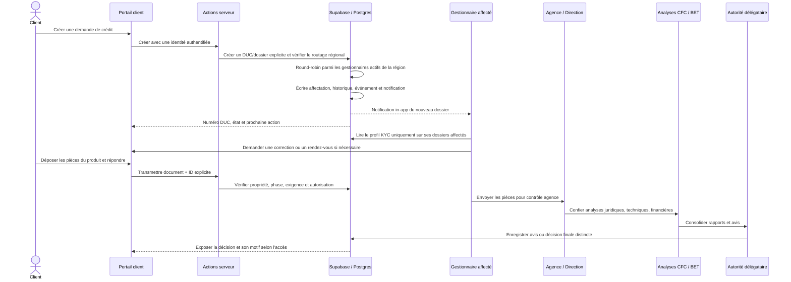
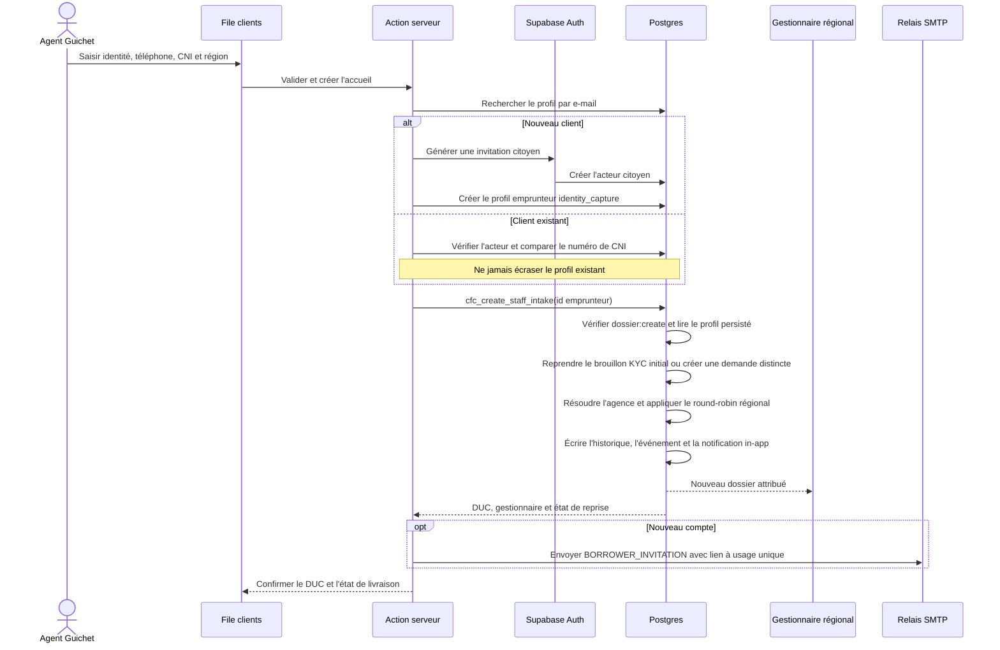
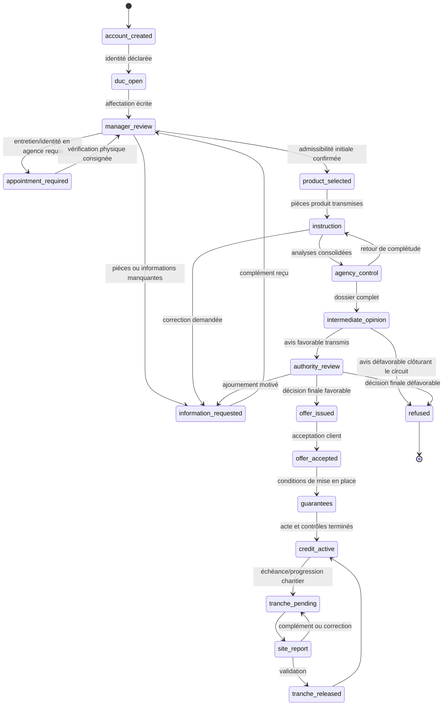

# Guichet commercial — besoins métier et workflow cible

> **Statut :** spécification de travail issue du compte rendu fourni par le CFC et des pages publiques consultées le 19 novembre 2026. Elle distingue les règles explicites, les décisions prises dans ce projet et les sujets qui attendent une validation interne. Elle ne remplace ni le catalogue métier officiel ni la délégation de pouvoirs.

## Objectif

Faire du portail le point d'entrée et de suivi cohérent des relations clients, des comptes d'épargne, des demandes de crédit et de leur instruction. Le client peut préparer à distance tout ce qui ne requiert pas sa présence. Le système indique clairement les étapes qui exigent un entretien ou une vérification physique, conserve le dossier unique client et expose les décisions sans confondre un avis intermédiaire avec l'accord final.

Le compte rendu métier est la source du parcours cible. Les pages publiques du CFC sont utilisées comme références complémentaires; lorsqu'elles se contredisent entre elles ou avec le compte rendu, le système ne transforme pas cette différence en règle exécutable sans validation interne.

## Décisions et limites

| Sujet | Règle documentée | Conséquence pour l'application |
|---|---|---|
| Préparation à distance | Le client peut réaliser le maximum de démarches avant les étapes physiques. L'entretien en agence et la vérification d'identité restent en présentiel dans le processus décrit. | Permettre saisie, dépôt, suivi et échanges à distance; afficher un rendez-vous/contrôle en agence comme une étape bloquante explicite. Ne pas présenter une vérification documentaire en ligne comme une identité vérifiée. |
| Dossier client | Un DUC central regroupe identité, pièces, demandes, affectation, historique et échanges. | Le DUC est une racine client; une demande de crédit reste un dossier enfant identifié et suivi explicitement. Les lectures KYC complètes restent limitées au gestionnaire affecté. |
| Plusieurs demandes | **Décision projet confirmée le 19 novembre 2026 :** plusieurs demandes de crédit peuvent rester ouvertes simultanément. | Chaque brouillon/demande possède son ID et son suivi. Aucun changement d'une demande ne choisit implicitement le dossier le plus récent. |
| Crédit actif | Le compte rendu dit que les crédits simultanés ne sont pas admis ou n'ont pas été confirmés. **Décision projet confirmée : plusieurs demandes, un seul crédit actif après accord.** | À l'activation du contrat, vérifier qu'aucun autre crédit actif n'existe pour le client. Le modèle actuel ne possède pas encore de contrat de crédit durable distinct de `loan_offers`; cette règle ne peut pas être imposée de façon fiable en se basant uniquement sur une offre. |
| Épargne | Un compte d'épargne peut exister sans demande de crédit; certains crédits peuvent exiger une épargne; plusieurs comptes d'épargne par client sont permis. | Les comptes d'épargne ne sont pas des enfants obligatoires d'une demande de crédit. Les exigences d'épargne sont déterminées par produit. Le modèle doit permettre plusieurs comptes par client sans unicité par dossier/citoyen. |
| Compte d'opérations | Le compte d'opérations utilisé pour les débits/remboursements est distinct du compte d'épargne. | Ne jamais réutiliser `savings_accounts` pour stocker un compte d'opérations. Un modèle dédié et un rapprochement explicite sont nécessaires. |
| Catalogue | Les taux, plafonds, apports, durées, éligibilité et pièces doivent venir du catalogue actualisé fourni par le CFC. | Les seeds locaux ne sont pas une source de vérité métier. Les données runtime viennent des tables de référence effectives. Les valeurs d'essai ou publiques non confirmées restent désactivées jusqu'à validation. |
| Prestataires | Le client peut choisir un BET de son choix; l'examen CFC peut demander des corrections. Le CFC dispose de notaires conventionnés, mais le client peut proposer un autre notaire sous conditions, avec un délai potentiel supérieur. | Le workflow accepte un partenaire CFC ou un professionnel proposé par le client; l'approbation/agrément et le délai sont des données de décision, pas un nom libre ni une liste codée dans l'interface. |
| Avis et accord | Un avis favorable permet au dossier de poursuivre le circuit. Seule l'autorité délégataire accorde le crédit. | Les décisions intermédiaires et la décision finale sont des événements différents, avec auteur, instance, montant de compétence, fondement et date. |

## Parcours métier cible

```mermaid
flowchart LR
  subgraph P1[1 · Entrée en relation et DUC]
    A[Créer le compte] --> B[Saisir l'identité et le besoin]
    B --> C[Préparer les pièces KYC à distance]
    C --> D[Créer le DUC]
    D --> E[Affecter un gestionnaire régional]
    E --> F[Notifier le client et le gestionnaire]
    F --> G[Pré-vérifier les données et l'éligibilité]
    G --> H{Entretien et contrôle physique requis?}
    H -->|Oui| I[Présenter le rendez-vous en agence]
    H -->|Informations manquantes| J[Demander un complément avec motif]
    J --> G
    I --> K[Gestionnaire consigne la vérification physique]
  end

  subgraph P2[2 · Instruction et analyses]
    K --> L[Choisir un produit depuis le catalogue effectif]
    L --> M[Transmettre les pièces propres au produit]
    M --> N[Contrôle de complétude et conformité]
    N --> O{Dossier complet?}
    O -->|Non| J
    O -->|Oui| Q[Analyse juridique, technique et financière]
    Q --> R{BET requis?}
    R -->|BET CFC ou choisi par le client| S[Rapport BET et corrections éventuelles]
    R -->|Non| T[Consolider les analyses]
    S --> T
  end

  subgraph P3[3 · Contrôle, avis et décision]
    T --> U[Contrôle agence et retours éventuels]
    U --> V[Transmission aux services compétents]
    V --> W[Recueillir les avis intermédiaires]
    W --> X[Résoudre l'autorité délégataire effective]
    X --> Y{Décision finale}
    Y -->|Complément| J
    Y -->|Refus motivé| Z[Clôturer cette demande]
    Y -->|Accord| AA[Émettre l'offre et notifier le client]
  end

  subgraph P4[4 · Mise en place]
    AA --> AB[Accepter l'offre]
    AB --> AC[Contrôler apport, garanties et assurances]
    AC --> AD[Choisir notaire conventionné ou proposé]
    AD --> AE[Préparer, signer et enregistrer les actes]
    AE --> AF[Activer un contrat de crédit]
  end

  subgraph P5[5 · Déblocages et suivi]
    AF --> AG[Programmer une tranche]
    AG --> AH[Visite et preuve d'avancement]
    AH --> AI[Rapport avec observations et photos]
    AI --> AJ[Avis et validation selon délégation]
    AJ --> AK[Exécuter le déblocage en agence]
    AK --> AL[Actualiser le suivi client et siège]
    AL --> AG
  end
```



Le compte rendu ne décrit pas le remboursement, la clôture du prêt ni le recouvrement. Les guides publics du CFC vont plus loin et décrivent ces étapes; elles restent une tranche métier distincte à compléter avec les services de remboursement et de recouvrement.

## Séquence d'affectation et de traitement



### Accueil du client au Guichet — flux livré

La file opérationnelle `/portail-cfc/clients` expose l'action aux rôles auxquels le catalogue accorde `dossier:create`. Elle collecte seulement les informations de contact et de routage; le formulaire ne donne pas au Guichet un accès de lecture au profil KYC complet.



Une défaillance de création du DUC supprime l'identité Auth créée pendant cette tentative. Une panne SMTP ne supprime pas le compte ni le dossier : le Guichet reçoit un avertissement et peut renvoyer l'invitation depuis les outils de gestion. La liste des destinations est construite côté base à partir du catalogue `agencies` et des affectations `GESTIONNAIRE` actuellement actives; une région non routable n'est donc pas proposée. L'agence et le gestionnaire finaux sont recalculés côté base. Les notifications d'affectation sont créées dans la même transaction que le DUC.

### Données de démonstration locales et staging

Le seed local/staging provisionne 16 comptes du personnel, 56 comptes emprunteur et 57 demandes réparties sur les cinq phases actuellement alimentées (17, 10, 10, 10, 10). Il fournit des profils KYC et des identifiants synthétiques stables à partir des comptes de démonstration; les choix fermés sont lus dans `ref.kyc_option`. Les versements d'épargne sont datés et rapprochés des soldes, et les tranches de déblocage restent planifiées tant qu'aucun décaissement réel n'est enregistré. Les fixtures de clôture restent absentes tant que le modèle ne porte pas le cycle de contrat et de remboursement décrit plus haut.

## Machine à états proposée

Les libellés d'interface doivent venir du catalogue de processus; les codes ci-dessous illustrent les états métier et ne remplacent pas l'historique des événements.



`intermediate_opinion` ne vaut jamais `offer_issued`. Une demande refusée est clôturée; le client peut ouvrir une nouvelle demande selon les règles catalogue, tandis que l'historique précédent reste consultable.

## Modèle métier et écarts de données

```mermaid
classDiagram
  class Actor {
    uuid id
    actor_type type
    kyc_state state
  }
  class Dossier {
    uuid id
    string duc_code
    string service_code
    string current_phase
    uuid citizen_id
  }
  class AssignmentHistory {
    uuid dossier_id
    uuid assigned_to
    string region
    string method
    timestamptz started_at
    timestamptz ended_at
  }
  class DossierDocument {
    uuid dossier_id
    string doc_type_code
    string status
    string phase
  }
  class SavingsAccount {
    uuid citizen_id
    uuid dossier_id
    string account_number
    decimal balance
  }
  class LoanOffer {
    uuid dossier_id
    string status
    decimal offer_amount
  }
  class CreditContract {
    uuid citizen_id
    uuid dossier_id
    string lifecycle_state
  }
  class OperationAccount {
    uuid citizen_id
    string account_number
    string status
  }
  class BusinessPartner {
    string partner_type
    string accreditation_status
    string network_status
  }
  Actor "1" --> "0..*" Dossier : owns
  Dossier "1" --> "0..*" AssignmentHistory : audit trail
  Dossier "1" --> "0..*" DossierDocument : evidence
  Actor "1" --> "0..*" SavingsAccount : independent savings
  Dossier "1" --> "0..*" LoanOffer : offer lifecycle
  Actor "1" --> "0..*" CreditContract : history; max 1 active
  Actor "1" --> "0..*" OperationAccount : separate from savings; count policy pending
  Dossier "0..*" --> "0..*" BusinessPartner : assigned or client-proposed
```

The current schema has `dossiers`, assignment history, documents, savings accounts and loan offers. `savings_accounts` has no one-account-per-citizen uniqueness constraint, which is compatible with several savings accounts. The account-number fallback on dossier reads and the absence of a separate operation-account/credit-contract entity require a data-model audit before activating the new policies. The current `loan_offers` table describes offers, not whether a loan has become an active contract. Contract history may be unlimited; a database-level concurrency rule must prevent more than one contract in an active state at a time. The permitted number and ownership model for operation accounts remain unconfirmed.

## Matrice de traçabilité

| Exigence du compte rendu | Données et comportement attendus | État connu de l'application | Critère d'acceptation |
|---|---|---|---|
| Préparer le maximum à distance | Brouillon, documents, conversation, état et rendez-vous en agence visibles | Portail client, KYC et demandes existent; la frontière présentiel/distance n'est pas encore matérialisée comme étape bloquante dédiée | Un client sait précisément ce qu'il peut faire à distance et ce qui exige sa présence; le KYC ne passe pas à « vérifié » sans trace physique autorisée |
| DUC et conseiller régional | Affectation atomique, gestionnaire, motif manuel audité, notification | Round-robin régional, historique et notifications existent | Chaque demande a un gestionnaire actif de la région; réaffectation ADMIN auditée et notification du nouvel affecté |
| Vérification KYC et profil | Seul le gestionnaire affecté consulte/décide, puis consigne entretien/contrôle physique | Portée KYC régionale/gestionnaire mise en place; événement de vérification physique absent | Tentatives d'un autre staff refusées au niveau DB; preuve, date, agence et vérificateur conservés |
| Catalogue actualisé par produit | Conditions, plafonds, taux, durée et exigences versionnés | Catalogue Supabase existe; plusieurs valeurs de seed sont provisoires et ne sont pas rapprochées des formulaires CFC remis | La page n'utilise que les lignes effectives validées par le propriétaire du catalogue; absence de données signifie erreur visible |
| Épargne autonome et multiple | Un client peut ouvrir plusieurs comptes; seules les offres concernées imposent épargne | Table d'épargne permet plusieurs comptes; exigences produit/stage existent | Aucun formulaire crédit n'ouvre automatiquement un carnet; chaque produit déclare explicitement sa relation avec l'épargne |
| Demandes multiples et crédit actif unique | Plusieurs demandes ouvertes; un seul contrat actif après accord | Demandes distinctes présentes; contrat actif séparé à créer | Test DB simultané prouve qu'une seule activation réussit pour un citoyen, sans supprimer ses autres demandes |
| Compte d'opérations séparé | Remboursement et débit sur compte d'opérations distinct de l'épargne | Schéma actuel n'a pas de table dédiée; dossier conserve un `account_number` générique | Écritures et rapprochements ne modifient jamais un compte d'épargne à partir d'un numéro d'opérations |
| BET choisi par le client ou BET agréé | Association du professionnel et statut de conformité; rapport/corrections attachés | Champs `bet_assigned` en texte libre historiques; registre de partenaires et approbation à vérifier | BET accrédité ou proposé explicitement, rapport versionné, demande de correction journalisée |
| Notaire conventionné ou proposé | Choix client, vérification d'éligibilité, délai/exception documentés | `notary_assigned` en texte libre; registre partenaire à vérifier | Notaire choisi rattaché comme acteur/partenaire, convention et statut visibles; choix externe soumis au contrôle CFC |
| Avis distinct de la décision finale | Avis intermédiaire puis décision d'instance compétente, motif et signature | Délibérations et offres existent; codes comité/thresholds actuels à rapprocher | Aucun avis ne génère une offre; la décision finale référence une délégation en vigueur et est signée |
| Décaissements par tranche | Ordre, inspection, photos, rapport, avis, validation, paiement et rapprochement | Modèle de déblocages/suivi présent à auditer avec les tableurs et l'ERP en cours | Chaque tranche ne peut être exécutée qu'après exigences, rapport et validations; le siège voit l'opération sans contourner la RLS agence |
| Remboursement, clôture, recouvrement | Compte d'opérations, échéances, incidents, recouvrement, fin de prêt | Peu documenté pendant la réunion; guides publics le décrivent davantage | Atelier métier dédié; aucune procédure de recouvrement inventée depuis un simple intitulé d'état |

## Délégations et seuils : blocage explicite

Les informations transmises ne sont pas compatibles entre elles et les données seed actuelles ne sont pas conformes à ces sources. Le compte rendu évoque des seuils agences/siège, puis DG, comités et conseil; il précise lui-même que les seuils agences doivent être rapprochés de la délégation officielle. Les lignes actuellement seedées dans `ref.approval_threshold` (`CGR_DELEGATION` jusqu'à 10 M, `CRC_ARBITRAGE` de 10 à 25 M, `PCA_INSTITUTIONNEL` au-delà) ne correspondent pas aux niveaux décrits dans les pages publiques du CFC.

La page CFC « Pratiques » publiée en ligne décrit CIEPA en agence sous 8 M, CRC entre 8 et 100 M, CGR de 100 à 300 M et Conseil d'administration de 300 à 500 M; la page des comités spécialisés décrit le rôle du Comité de crédit à partir de 100 M jusqu'à 300 M. Le guide classique plus ancien parle de décision agence jusqu'à 8 M et d'avis au-delà. Ces sources publiques ne remplacent pas l'acte interne de délégation applicable. Les trois lignes seedées ne doivent donc pas être exposées ni utilisées comme règles de décision.

**Blocage de mise en production :** récupérer la version signée/effective de la délégation de pouvoirs, les catégories d'agence, les montants inclusifs/exclusifs, les autorités d'avis et d'accord, les signatures requises, les exceptions et la date d'effet. Une fois reçue, la stocker en version dans Supabase et couvrir chaque frontière par test DB.

## Références et précautions

- Compte rendu fourni par le CFC dans cette session, sections 4 et 5 (« collecte des besoins métier » et « processus d'octroi »). Ce document contient ses propres réserves sur les délégations et sur le cycle remboursement/recouvrement.
- [Pratiques du CFC — parcours, instances de décision, notification et mise en place](https://creditfoncier.cm/fr/qui-sommes-nous/gouvernance/pratiques.html). Les montants publiés doivent être rapprochés de la version interne applicable avant automatisation.
- [Comités spécialisés du CFC](https://creditfoncier.cm/fr/qui-sommes-nous/gouvernance/comites-specialises.html). Confirme le rôle publié du Comité de crédit dans les tranches à partir de 100 M et jusqu'à 300 M.
- [Guide pratique du prêt foncier classique](https://www.creditfoncier.cm/fr/component/phocadownload/category/5-le-guide-de-l-emprunteur.html?download=3%3Aguide-pret-foncier-classique). Guide public ancien; il décrit analyse, décision/avis, garanties, assurances et déblocages par acomptes.
- [Guide pratique du prêt foncier locatif](https://creditfoncier.cm/fr/guide-pratique-pret-foncier-locatif.html). Décrit un parcours plus long, de l'accueil à l'extinction de la relation, avec épargne éventuelle, décision, mise en place, suivi chantier, remboursement et documents de fin.
- [Prêt foncier classique ordinaire — catalogue public](https://www.creditfoncier.cm/fr/produits-prets/pret-foncier-classique/pret-foncier-classique-ordinaire.html). Donne les caractéristiques affichées publiquement et les documents utiles; ces valeurs ne remplacent pas les modèles de catalogue et formulaires internes demandés pendant la réunion.
- [Prêt foncier classique acquéreur](https://www.creditfoncier.cm/fr/produits-prets/pret-foncier-classique/pret-foncier-classique-acquereur.html). Décrit notamment des documents fonciers non requis à l'étape initiale pour cette variante, illustrant pourquoi les pièces doivent dépendre du produit et de l'étape.
- [Recherche comparée des sources et des données actuelles](../../research/cfc-commercial-counter-source-research.md). Conserve les valeurs et contradictions observées dans les pages CFC, les notes de réunion, les seeds et les migrations; aucune de ces divergences ne doit être réglée par supposition.
- [Spécification de l'administration et des données de démonstration](2026-11-19-admin-governance-console.md). Définit les modules d'administration, la séparation fixtures/configuration et les vues multi-formats.

## Critères avant décision métier

- Confirmer le catalogue officiel et ses propriétaires (produits, taux, plafonds, apports, pièces, conditions, exceptions, versions et dates d'effet).
- Fournir la délégation de pouvoirs applicable et résoudre les seuils contradictoires.
- Valider comment et à quel moment le gestionnaire prouve la présence et la vérification physique du client.
- Fournir les modèles de demande, lettre d'offre, conventions, rapports BET et rapport de visite.
- Confirmer les acteurs de chacune des analyses et les règles d'orientation vers BET/notaire externe.
- Documenter le compte d'opérations, ses mouvements/rapprochements, ainsi que le cycle de remboursement/clôture/recouvrement.
- Définir les états du contrat qui comptent comme « crédit actif » et le comportement si deux demandes sont déjà en instruction au moment de la première activation.
